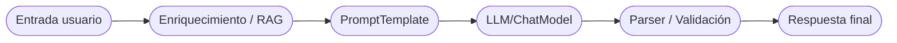

# 1. Introducción a LangChain y las apps con LLM

Estos apuntes siguen la estructura usada en `RabbitMQ/` para mantener los temas ordenados. Aquí se resume qué resuelve LangChain y cómo encaja en el ecosistema de herramientas para LLMs.

## 1.1 ¿Qué es LangChain?

**LangChain** es un conjunto de componentes y utilidades para construir aplicaciones que consumen modelos de lenguaje. Aporta:

- Abstracciones comunes: `ChatModel`, `LLM`, `Embeddings`, `Runnable` para componer flujos.
- Plantillas de prompts, parsers de salida y manejo de contexto (memorias).
- Integraciones listas con proveedores (OpenAI, Google, Anthropic, Azure, Hugging Face), stores vectoriales y herramientas.
- Helpers para trazabilidad (`callbacks`), depuración y despliegue rápido (ej.: Streamlit).

Cuándo usarlo:

- ✅ Necesitas experimentar rápido con varias cadenas / agentes y cambiar de modelo sin reescribir código.
- ✅ Quieres componer pasos (parsear, enriquecer, recuperar documentos, llamar modelo, post-procesar).
- ⚠️ Si la app es muy simple (una llamada directa a la API), usar solo el SDK del proveedor puede ser suficiente.

## 1.2 Comparativa rápida de enfoques

| Opción | Ventaja principal | Coste/limitación |
| ------ | ----------------- | ---------------- |
| SDK directo del proveedor | Control fino y mínimo overhead | Tienes que construir memoria, parsers y reintentos a mano |
| LangChain | Componentes reutilizables, runners composables, muchas integraciones | Abstracción extra; hay que conocer los bloques para usarlos bien |
| LlamaIndex / Haystack | Centrado en RAG y data pipelines | Menos foco en agentes/herramientas (según caso) |

## 1.3 Componentes clave (versión corta)

- **PromptTemplates**: formatean cadenas/structs a partir de variables de entrada.
- **Runnables / Chains**: componen pasos secuenciales o en paralelo.
- **Memory**: conserva contexto de conversación o estado entre ejecuciones.
- **Output parsers**: transforman texto a estructuras (JSON, Pydantic) o aplican validación.
- **Tools**: funciones externas (APIs, DB) que un agente puede invocar.
- **Callbacks**: hooks para trazabilidad y métricas (LangSmith, OpenTelemetry, consola).

## 1.4 Diagrama mínimo (conceptual)

## 1.5 Qué cubrirán los siguientes capítulos

- 2: Preparación de entorno (Python, dependencias, API keys).
- 3: Conceptos básicos (runnables, prompts, memoria, parsers).
- 4: Proveedores y modelos (OpenAI, Google, locales).
- 5: RAG: embeddings, stores y retrieval.
- 6: Agentes y herramientas.
- 7: Buenas prácticas (credenciales, costes, observabilidad).
