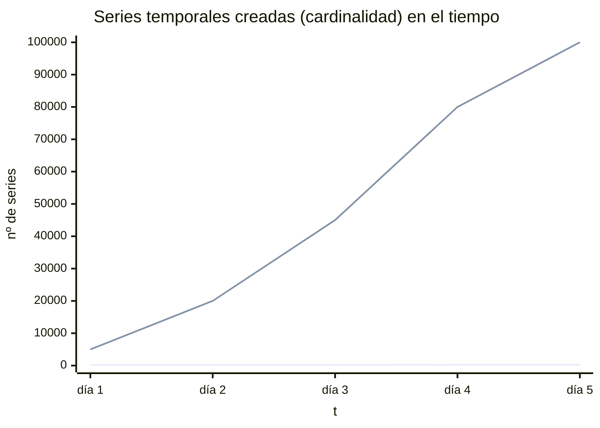
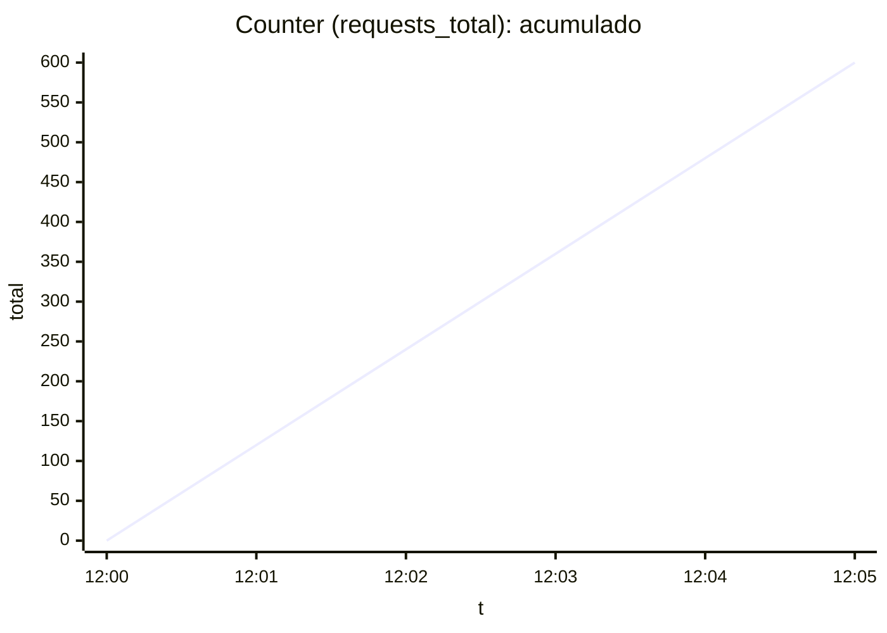
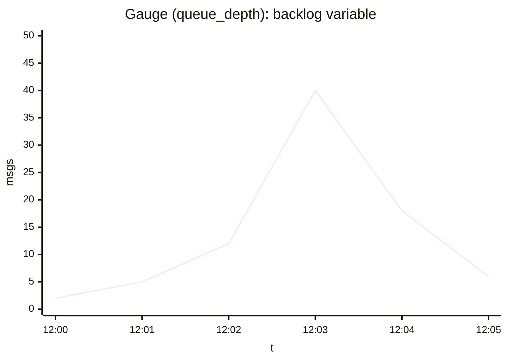
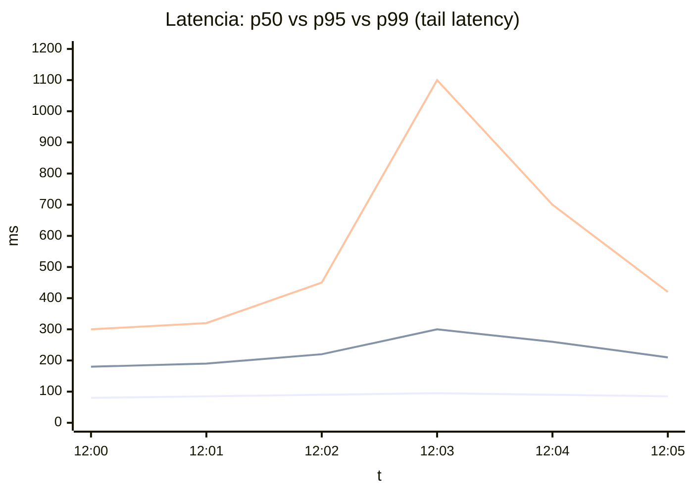
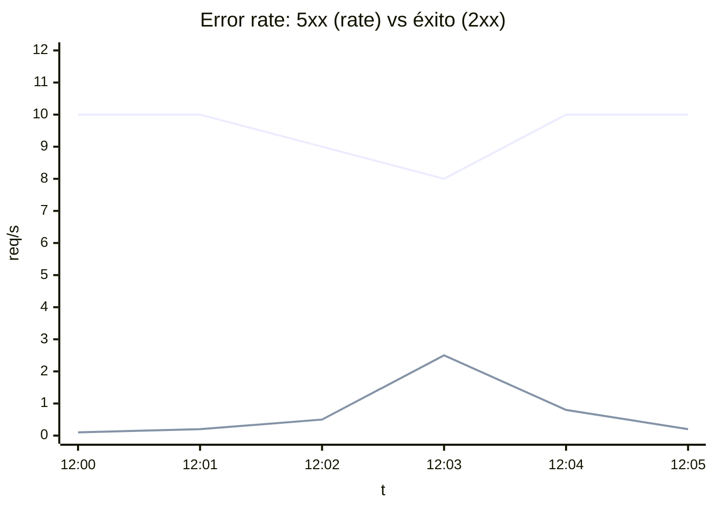

# Métricas en la observabilidad de sistemas distribuidos

## Introducción

En la observabilidad de sistemas distribuidos, las **métricas** proporcionan mediciones cuantitativas del comportamiento y rendimiento de los servicios. A diferencia de los *logs* (eventos detallados) o los *traces* (rastreos de peticiones), las métricas son valores numéricos que describen el estado del sistema en el tiempo, recopilados periódicamente.

Existen **cuatro tipos comunes** de métricas utilizadas para instrumentar sistemas: **contadores**, **gauges** (medidores), **histogramas** y **resúmenes (summaries)**, cada uno con un propósito conceptual específico. A continuación se profundiza en cada tipo, con definiciones, ejemplos de uso, interpretación, patrones de instrumentación y errores comunes a evitar.

## Convenciones mínimas (naming, unidades, semántica)

Antes de instrumentar, conviene acordar un **contrato semántico** mínimo. No es “tooling”: es consistencia operativa.

- **Unidades** (consistencia ante todo):
  - Latencias/duraciones: segundos o milisegundos, pero **una sola convención**.
  - Tamaños: bytes.
  - Tasas: `eventos/s` derivados de counters.
  - Ratios: `0..1` o `%`, pero **no mezclar**.
- **Convenciones típicas** (orientativas):
  - Counters: sufijo `_total` (totales acumulados).
  - Duraciones: sufijo `_seconds` o `_ms` (unidad explícita).
  - Tamaños: sufijo `_bytes`.
  - Ratios: sufijo `_ratio` (si es `0..1`).
- **Semántica de labels**:
  - Preferir labels de **baja cardinalidad** (`service`, `env`, `route` normalizada, `method`, `status_class=2xx|4xx|5xx`, `target_service`, `operation`).
  - Evitar labels con valores casi únicos (`userId`, `orderId`, `email`, `ip`, `documentUuid`, `sessionId`).

## Cardinalidad (sección crítica)

La **cardinalidad** es el número de combinaciones distintas de labels que genera una métrica. Cardinalidad alta implica **explosión de series temporales**, más coste, consultas más lentas y, en casos extremos, degradación o caída del sistema de métricas.

Reglas prácticas:
- Si un label puede tomar “muchísimos” valores (por ejemplo, **>100** de forma natural, o sin límite claro), sospecha.
- Si el label identifica “entidades” (usuarios, documentos, sesiones), **probablemente no pertenece a métricas** (mejor logs/trazas).
- Si necesitas segmentación granular por entidad, suele resolverse con:
  - logs estructurados + búsqueda,
  - trazas + filtros,
  - o métricas de negocio con dimensiones controladas (catálogos cerrados).

## Contadores (Counter)

Un **contador** es una métrica acumulativa monótona que representa un valor numérico que **solo puede incrementarse** (o restablecerse a cero, típicamente al reiniciar el servicio) y **nunca disminuye**. Lleva la cuenta total de eventos o acumulaciones a lo largo del tiempo.

**Ejemplos típicos**
- Número de solicitudes atendidas por un servicio.
- Número de tareas completadas.
- Número de errores ocurridos desde el arranque.

### Cómo interpretarlo

El valor bruto de un contador representa el total histórico desde el arranque. Para extraer valor operativo se calcula su **tasa de cambio** (`rate`) o su **delta** en una ventana de tiempo (eventos/segundo, eventos/minuto, etc.).

Cuando una instancia se reinicia, el contador vuelve a cero. Por eso:
- las tasas deben calcularse con funciones que **manejen resets** correctamente,
- y el análisis no debe basarse en el valor absoluto.

### Patrones de instrumentación

- Inicializar en 0 e **incrementar** por evento.
- Contador de solicitudes al entrar a un handler HTTP.
- Contador de errores al atrapar excepciones (o derivar de `requests_total` por clase de estado).
- Usar etiquetas de baja cardinalidad para segmentar: `route` normalizada, `method`, `status_class`, `operation`.

### Errores comunes

- **Decrementar** un contador (no procede; para eso está el gauge).
- “Resetear” manualmente el contador fuera de un reinicio del proceso.
- Interpretar el valor absoluto sin convertirlo a tasas/deltas.
- Usar contadores para valores que bajan (p. ej. usuarios conectados).

## Gauges (Medidores)

Un **gauge** representa un valor numérico en un instante dado, el cual **puede subir o bajar libremente**. Refleja un estado momentáneo, ideal para magnitudes que fluctúan.

**Ejemplos típicos**
- Uso de CPU (%), memoria, disco.
- Número de peticiones activas (*in-flight*).
- Longitud de una cola.
- Conexiones activas en un pool.

### Cómo interpretarlo

Es un **snapshot**: su valor en cada punto es el estado actual. En series temporales importan picos, valles y valores sostenidos cerca de límites (saturación).

Reglas habituales de agregación (dependen de la semántica):
- **CPU%**: `avg` para tendencia global; `max` para detectar “pod caliente”.
- **Backlog/queue depth**: `sum` (impacto total) y `max` (peor cola).
- **Conexiones activas / pools**: `max` para saturación; `avg` para tendencia.

### Patrones de instrumentación

- **Muestreo directo**: leer el valor al exponer la métrica (CPU, memoria, etc.).
- **Ajuste por eventos**: incrementar/decrementar al abrir/cerrar conexiones, entrar/salir de sección crítica, etc.
- Cuidar concurrencia y atomicidad al modificar gauges.

### Errores comunes

- Usar gauges para totales acumulativos (debería ser counter).
- Interpretar un gauge como tasa o total histórico.
- Instrumentar gauges “ruidosos” o sin pregunta operativa.
- Lógica incompleta (incrementos sin decrementos) que deja el gauge desfasado.

## Histogramas

Un **histograma** permite observar la **distribución de valores**: agrega observaciones en **rangos predefinidos (buckets)** y contabiliza cuántos eventos caen en cada rango. Normalmente expone:
- contadores por bucket (frecuencias acumuladas),
- `_count` (número total de observaciones),
- `_sum` (suma total de valores observados).

**Ejemplos típicos**
- Latencia de respuesta HTTP / duración de operaciones.
- Tamaño de payloads.
- Duración de consultas a base de datos.

### Cómo interpretarlo

Los buckets suelen ser **acumulativos**: el bucket `<=X` incluye también los eventos `<=` a límites menores. Con el histograma se pueden estimar **percentiles** (p95/p99) de forma aproximada según la granularidad y elección de buckets.

Guía rápida:
- Si **p99** sube pero **p50** se mantiene, suele haber problemas de **cola (tail latency)**: contención, GC, locks, downstream lento, timeouts/retries.
- La calidad del p95/p99 depende de que tengas buckets alrededor de tus umbrales relevantes (por ejemplo, alrededor de tu SLO).

### Patrones de instrumentación

- Elegir buckets coherentes con el dominio (ms/s para latencias, bytes para tamaños).
- Registrar una observación por evento relevante (`observe(valor)`).
- Usar histogramas cuando importa la forma de la distribución (colas largas, outliers, picos).
- Mantener buckets consistentes entre servicios si se quiere agregación global.

### Errores comunes

- Buckets mal definidos (demasiados: coste; demasiado pocos: poca resolución).
- No entender la acumulación de buckets y leerlos como frecuencias independientes.
- Mezclar histogramas con buckets distintos (dificulta/impide agregación).
- Usar histogramas donde bastaría con un counter/gauge.

## Resúmenes (Summary)

Un **summary** también mide distribución, pero **calcula quantiles en el cliente** (la propia aplicación) sobre una ventana deslizante. Exposición típica:
- `quantile="0.5"`, `quantile="0.9"`, `quantile="0.99"`,
- `_count` y `_sum`.

### Cómo interpretarlo

El summary entrega percentiles directamente **por instancia**, con margen de error dependiente del algoritmo y de la configuración. Suele reflejar una ventana temporal (no “desde el inicio”).

### Patrones de uso

- Cuando no se conocen buckets adecuados.
- Cuando se quiere un conjunto pequeño de percentiles por instancia.
- Cuando se acepta el trade-off: menos detalle de distribución a cambio de simplicidad local.

### Limitaciones y errores comunes

- **No agregable globalmente** para percentiles: los quantiles de varias instancias no se pueden combinar correctamente para un p95/p99 “global”.
- Menos detalle de la distribución completa: solo los percentiles configurados.
- Inestabilidad al inicio/reinicio (necesita “calentarse” con muestras).

En sistemas distribuidos con necesidad de agregación, suele preferirse **histograma**.

## Métricas instantáneas vs. acumulativas

- **Acumulativas**: se acumulan en el tiempo (p. ej. counters).
  - Se interpretan mejor como **deltas** o **rates**.
- **Instantáneas**: estado actual (p. ej. gauges).
  - Se interpretan directamente en cada punto (picos, tendencia, sostenidos).

Las tasas (RPS, errores/seg) suelen ser **métricas derivadas** calculadas a partir de counters.

## Resolución temporal y agregación

### Resolución temporal (muestreo)

- Intervalos cortos: más detalle y detección rápida, más ruido y coste.
- Intervalos largos: menos coste, se pierden picos cortos.
- Patrón habitual: alta resolución en corto plazo + downsampling para histórico.

### Agregación en el tiempo

- Promedios: carga “típica”.
- Máximos: picos y peores casos.
- Ventanas móviles: filtrar ruido, pero cuidado con ocultar incidentes breves.

### Agregación entre instancias

- **Counters**: suele tener sentido **sumar** (totales globales) y derivar tasas globales.
- **Gauges**: depende de semántica (sumar/promediar/máximo).
- **Histogramas**: agregables bucket a bucket si comparten buckets.
- **Summaries**: **no agregables** para percentiles globales.

En alerting, conviene combinar vistas agregadas y por instancia para no diluir fallos localizados.

## Relación con señales de degradación, errores y saturación

Las “cuatro señales doradas” (SRE) suelen mapear así:

- **Latencia (degradación)**: histogramas (p95/p99), o summaries por instancia.
- **Errores**: counters (errores totales) y derivación a error rate/ratio.
- **Saturación**: gauges (CPU, memoria, colas, pools, etc.).
- **Tráfico**: counters (solicitudes totales) y derivación a RPS/throughput.

Tabla de referencia:

| Señal | Métricas típicas | Tipo |
|------|-------------------|------|
| Degradación (latencia) | Duración de requests/operaciones, p95/p99 | Histograma / Summary |
| Errores | 5xx, excepciones, timeouts (para rate/ratio) | Counter |
| Saturación | CPU, memoria, cola, pool, conexiones activas | Gauge |
| Tráfico | Requests totales, mensajes totales (para rate) | Counter (y rate derivado) |

## Qué se mide y cómo (arranque práctico / hands-on)

Esta sección está pensada como “arranque práctico”: listas y ejemplos que te permiten instrumentar un backend con criterio, antes de entrar en teoría más avanzada.

### 1) HTTP (servidor) — salud básica del API

**Qué se suele medir**
- **RPS / throughput**: peticiones por segundo por ruta y método.
- **Latencia**: p50/p95/p99 por ruta.
- **Errores**: ratio 4xx/5xx, timeouts, excepciones no controladas.
- **Concurrencia**: requests en vuelo.

**Qué se suele usar para medirlo (fuentes/instrumentación)**
- Middleware/filtros del framework web (interceptors/filters).
- Instrumentación automática del servidor HTTP (router + handler).
- Instrumentación manual en puntos críticos (endpoints de negocio).

**Métricas típicas**
- `http.server.requests_total` (counter; frecuentemente segmentado por `status_class`)
- `http.server.request.duration_seconds` (histogram/summary)
- `http.server.in_flight` (gauge)
- `http.server.timeouts_total` (counter; si se distingue)

**Ejemplos**
- `http_server_requests_total{route="/v1/payments",method="POST",status_class="2xx"}`
- `http_server_request_duration_seconds_bucket{route="/v1/payments",method="POST",le="0.25"}`
- `http_server_in_flight{route="/v1/payments"}`

### 2) HTTP (cliente) / llamadas a dependencias — dónde se va el tiempo

**Qué se suele medir**
- **Latencia** y **error rate** hacia cada dependencia (por servicio destino y operación).
- **Retries** y **timeouts**.
- Estado/rechazos de patrones de resiliencia (circuit breaker / rate limiter / bulkhead) si aplica.

**Qué se suele usar para medirlo**
- Interceptores del cliente HTTP (client filters).
- Instrumentación asociada a librerías de resiliencia.
- Wrappers alrededor de SDKs externos.

**Métricas típicas**
- `http.client.requests_total` (counter)
- `http.client.request.duration_seconds` (histogram)
- `http.client.timeouts_total` (counter)
- `http.client.retries_total` (counter)
- `circuit_breaker.opened_total` (counter) / `circuit_breaker.state` (gauge)
- `rate_limiter.rejections_total` (counter) / `bulkhead.rejections_total` (counter)

**Ejemplos**
- `http_client_requests_total{target_service="users",operation="searchUsers",status_class="5xx"}`
- `http_client_request_duration_seconds_bucket{target_service="payments",operation="createPayment",le="1"}`
- `http_client_retries_total{target_service="authority",operation="getAuthz"}`
- `circuit_breaker_opened_total{name="authority"}`
- `rate_limiter_rejections_total{name="bank_provider"}`

### 3) Base de datos — rendimiento y límites reales

**Qué se suele medir**
- **Latencia de queries** (por tipo o por operación lógica).
- **Errores**: timeouts, deadlocks, errores de conexión.
- **Pool de conexiones**: activas, idle, espera, saturación.
- **Transacciones**: duración (si es relevante).

**Qué se suele usar para medirlo**
- Instrumentación del driver o del ORM.
- Métricas del pool de conexiones.
- Envoltorios alrededor de repositorios/DAO para “operaciones de negocio”.

**Métricas típicas**
- `db.client.operations_total` (counter) + `db.client.operation.duration_seconds` (histogram)
- `db.errors_total` (counter)
- Pool:
  - `db.pool.active` (gauge)
  - `db.pool.idle` (gauge)
  - `db.pool.pending` (gauge)
  - `db.pool.acquire.duration_seconds` (histogram)
- `db.transactions.duration_seconds` (histogram; si aplica)
- `db.deadlocks_total` (counter; si aplica)

**Ejemplos**
- `db_client_operation_duration_seconds_bucket{db="orders",operation="SELECT",le="0.05"}`
- `db_pool_active{pool="main"}`
- `db_pool_pending{pool="main"}`
- `db_errors_total{db="orders",error_type="timeout"}`

### 4) Mensajería (consumo/producción) — colas, lag y reintentos

**Qué se suele medir**
- **Producción**: mensajes publicados/s.
- **Consumo**: mensajes procesados/s.
- **Lag/backlog**: profundidad de cola, mensajes pendientes.
- **Tiempo de procesamiento** del handler.
- **Retries/DLQ**: reintentos, envíos a cola de muertos.

**Qué se suele usar para medirlo**
- Instrumentación en el productor y el consumidor (handler).
- Medición explícita del tiempo de proceso por mensaje.
- Contadores por resultado de consumo (ack/nack/retry).

**Métricas típicas**
- Producer:
  - `messaging.produced_total` (counter)
  - `messaging.produce.errors_total` (counter)
  - `messaging.produce.duration_seconds` (histogram opcional)
- Consumer:
  - `messaging.consumed_total` (counter)
  - `messaging.handler.duration_seconds` (histogram)
  - `messaging.consume.errors_total` (counter)
  - `messaging.retries_total` (counter)
  - `messaging.dead_lettered_total` (counter)
- Backlog/lag:
  - `queue.depth` (gauge)
  - `consumer.lag` (gauge; depende del sistema)

**Ejemplos**
- `messages_published_total{exchange="x.user",routing_key="user.registered"}`
- `messages_consumed_total{queue="q.user.registered"}`
- `message_handler_duration_seconds_bucket{queue="q.user.registered",le="0.5"}`
- `messages_retried_total{queue="q.user.registered"}`
- `messages_dead_lettered_total{queue="q.user.registered.dlq"}`

### 5) Caches (Redis u otras) — hit ratio y latencia

**Qué se suele medir**
- **Hit/miss ratio**.
- **Latencia** de get/set.
- **Errores**: timeouts, desconexiones.
- **Evictions** (si se expone).

**Qué se suele usar para medirlo**
- Instrumentación del cliente de cache.
- Wrappers en el acceso a cache de negocio.

**Métricas típicas**
- `cache.requests_total{result="hit|miss"}` (counter)
- `cache.operation.duration_seconds` (histogram)
- `cache.errors_total` (counter)
- `cache.evictions_total` (counter; si expuesto)

**Ejemplos**
- `cache_requests_total{cache="tokens",operation="GET",result="hit"}`
- `cache_requests_total{cache="tokens",operation="GET",result="miss"}`
- `cache_operation_duration_seconds_bucket{cache="tokens",operation="GET",le="0.01"}`
- `cache_errors_total{cache="tokens",error_type="timeout"}`

### 6) Runtime del servicio (proceso/JVM/GC/threads) — síntomas que explican degradaciones

**Qué se suele medir**
- CPU y memoria del proceso.
- Heap usado, pausas de GC, presión de memoria.
- Threads activos.
- Pools/colas internas (si el framework lo expone): activos, encolados, rechazos.

**Qué se suele usar para medirlo**
- Exposición estándar del runtime/proceso.
- Instrumentación del runtime (JVM, threads, GC).
- Instrumentación de ejecutores (thread pools) si existen.

**Métricas típicas**
- Proceso:
  - `process.cpu.usage` (gauge)
  - `process.memory.rss_bytes` (gauge)
  - `process.uptime_seconds` (gauge)
- JVM (si aplica):
  - `jvm.memory.used_bytes` / `jvm.memory.max_bytes` (gauge)
  - `jvm.gc.pause_seconds` (histogram)
  - `jvm.threads.live` (gauge)
- Ejecutores/pools (si aplica):
  - `executor.active` (gauge)
  - `executor.queued` (gauge)
  - `executor.rejected_total` (counter)

**Ejemplos**
- `process_cpu_usage`
- `process_memory_rss_bytes`
- `jvm_gc_pause_seconds_bucket{le="0.1"}`
- `jvm_threads_live`
- `executor_rejected_total{name="http_worker"}`

### 7) SLI de negocio — lo que importa al usuario/servicio

**Qué se suele medir**
- Operaciones completadas vs fallidas (y por qué) con catálogo controlado.
- Tiempo end-to-end de un flujo de negocio (si se puede medir).
- Abandono por paso (si aplica).
- Rechazos de negocio por razón (catálogo pequeño y estable).

**Qué se suele usar para medirlo**
- Instrumentación manual en service layer/puntos de dominio.
- Contadores por resultado de negocio (no confundir con 4xx/5xx).
- Dimensiones de bajo cardinalidad (`result="ACCEPTED|REJECTED|CANCELLED"`).

**Métricas típicas**
- `business.operations_total{operation, result}` (counter)
- `business.flow.duration_seconds{flow}` (histogram)
- `business.validation.rejections_total{reason}` (counter; reasons controladas)

**Ejemplos**
- `business_operations_total{operation="payment_confirm",result="success"}`
- `business_operations_total{operation="payment_confirm",result="insufficient_funds"}`
- `business_flow_duration_seconds_bucket{flow="onboarding",le="10"}`
- `business_validation_rejections_total{operation="otp_verify",reason="expired"}`

## Plantilla práctica por “cosa a medir”

Copia/pega para decidir rápido.

- **Fenómeno**: (p. ej. “latencia de POST /v1/payments”)
- **Tipo de métrica**: Counter / Gauge / Histogram / Summary
- **Unidad**: ms/s/bytes/%
- **Labels permitidos (baja cardinalidad)**: `service`, `env`, `route`, `method`, `status_class`, `target_service`, `operation`
- **Labels prohibidos (alta cardinalidad)**: `userId`, `orderId`, `documentUuid`, `email`, `ip`
- **Pregunta operativa**: “¿Qué haré si cambia?”
- **Ejemplo de métrica**: `http_server_request_duration_seconds_bucket{route="/v1/payments",method="POST",le="0.25"}`
- **Alerta (si aplica)**: basada en ratio/impacto, no en umbrales arbitrarios

## Glosario

### Serie temporal (time series)
Secuencia de valores indexados por tiempo: pares `(timestamp, valor)`. Una métrica en observabilidad se almacena y consulta como una o varias series temporales.

### Instancia
Réplica concreta que emite telemetría (p. ej., un pod/VM/proceso). El mismo “servicio” suele tener varias instancias y, por tanto, varias series por métrica.

### Agregación
Combinar valores de múltiples series o de un intervalo de tiempo para obtener un resumen.
- **Entre instancias**: sumar RPS de todas las réplicas, máximo de latencia, etc.
- **En el tiempo**: media móvil, máximo en 5 minutos, etc.

### Labels / Tags / Dimensiones
Metadatos asociados a una medición para segmentar y filtrar (por ejemplo `service`, `env`, `status`, `method`, `route`). Una “métrica” suele ser una *familia* de series diferenciadas por labels.

### Cardinalidad (de labels/tags)
Número de combinaciones distintas de labels. Cardinalidad alta = demasiadas series, costes altos y consultas lentas.
- Alta cardinalidad: `userId`, `orderId`, `email`, `ip`, `documentUuid`.
- Baja cardinalidad: `status_class` (2xx/4xx/5xx), `method`, `env`.

### Scrape / Muestreo / Intervalo de recolección
Frecuencia con la que se “lee” o recolecta una métrica (p. ej., cada 15s). Un intervalo muy corto aumenta volumen y coste; muy largo puede ocultar picos.

### Counter (contador)
Métrica **monótona** que solo incrementa (o se reinicia al arrancar el proceso). Útil para “totales”.
- Ej.: `requests_total`, `errors_total`, `db_queries_total`.

### Monotonicidad
Propiedad de no decrecer. Los counters son monotónicos **hasta que** ocurre un reinicio del proceso.

### Reset (reinicio del contador)
Cuando una instancia se reinicia, un counter vuelve a 0. Para análisis temporal, hay que tratarlo correctamente (si no, aparecen tasas negativas o saltos falsos).

### Delta
Diferencia entre dos lecturas consecutivas de un counter. Base para calcular tasas.

### Rate / Tasa
Velocidad de cambio de un counter (eventos por segundo/minuto), derivada temporal.
- Ej.: `requests/s`, `errors/s`. Suele calcularse sobre una ventana (p. ej., 5 minutos) para suavizar ruido.

### Gauge
Métrica que **sube y baja**, representa un estado o nivel actual.
- Ej.: `in_flight`, `queue_depth`, `heap_used_bytes`, `active_threads`.

### Histograma
Representa una **distribución** mediante conteos ena rangos (*buckets*) y permite estimar percentiles.
- En latencias, es el patrón típico cuando se necesitan p95/p99 a escala.

### Buckets (histogram buckets)
Rangos predefinidos donde se cuentan observaciones (p. ej. `<=10ms`, `<=50ms`, `<=100ms`…).
Normalmente son **acumulativos**: el bucket `<=100ms` incluye también lo de `<=50ms`.

### Percentil (p95/p99)
Valor por debajo del cual cae el 95%/99% de las observaciones en una ventana. Relevante para latencias porque revela colas (*tail latency*) que el promedio oculta.

### Outlier / Cola (tail)
Observaciones extremas que ocurren pocas veces pero impactan la experiencia (p. ej. p99 elevado).

### Summary
Métrica que mantiene estimaciones de percentiles por instancia. Suele ser menos agregable globalmente que histogramas.
