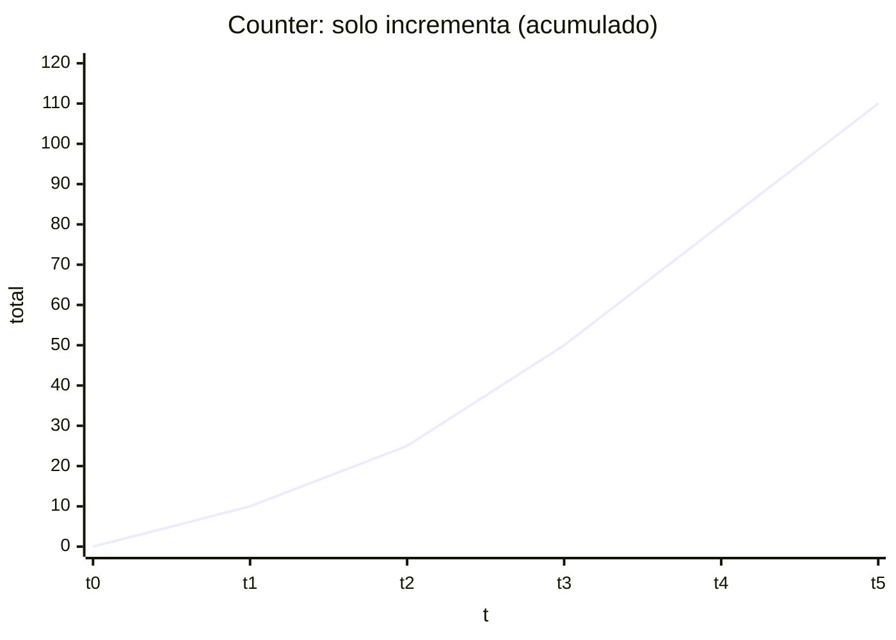
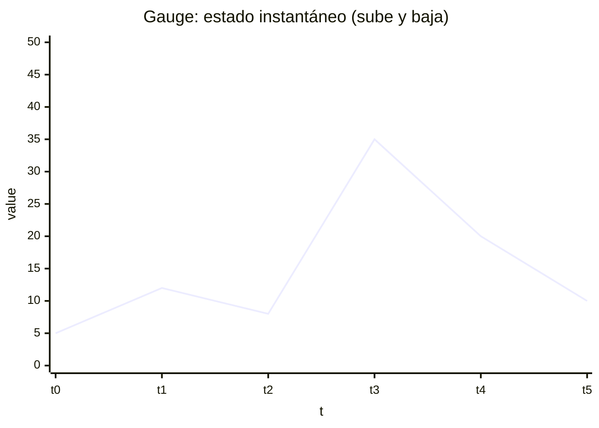
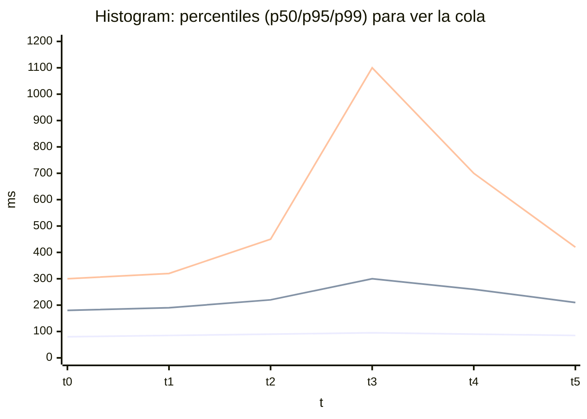

# Micrometer: instrumentación en Java/Spring

Micrometer es la **fachada (vendor-neutral)** estándar en el ecosistema Java/Spring para **definir y registrar métricas** sin acoplarte a un backend concreto (Prometheus, Datadog, New Relic, CloudWatch, etc.). 
La aplicaicón emite *meters* (Counter, Timer, Gauge, …) contra un `MeterRegistry`, y el **registry** se encarga de “publicar/exportar” al sistema de monitorización.

### Las 3 características de un sistema de métricas

- **Dimensionality**: en Micrometer una métrica se identifica por **nombre + tags** (tags = labels/dimensiones).
- **Rate aggregation (agregación por tasa)**: Micrometer emite *counters* y *timers*. El ratio de éstas se calcula en el backend (Prometheus/Grafana, Datadog, etc.).
- **Publishing**: se realiza a través del `MeterRegistry` concreto (p. ej. `PrometheusMeterRegistry`) y el endpoint de scrape (`/actuator/prometheus`) o el mecanismo de export correspondiente (push/pull según backend).

### Conceptos clave

#### `MeterRegistry`

- Es la **punto de entrada** donde el servicio **registra** y **actualiza** métricas.
- En Spring Boot, lo normal es inyectarlo en servicios/componentes para instrumentar sin estado global.
- En tests o local “sin backend”, se puede usar `SimpleMeterRegistry` para validar que los counters/timers/gauges se crean y evolucionan.

#### `Metrics.globalRegistry`

Es un **registro global y estático** donde se pueden registrar meters sin tener una referencia explícita a un `MeterRegistry`.

- Internamente suele ser un [**`CompositeMeterRegistry`**](#compositemeterregistry), es decir: un “contenedor” que puede delegar en uno o varios registries reales (Prometheus, Datadog, etc.).
- Su utilidad es cubrir escenarios donde no se inyección de dependencias o no se dispone de un registry accesible:
  - librerías reutilizables que no dependen de Spring,
  - código muy genérico/estático,
  - utilidades inicializadas fuera del ciclo de vida del contenedor,
  - aplicaciones que no usan un framework de inyección.

**Por qué es útil en librerías o código genérico**
- Permite instrumentar sin acoplarse a un framework (Spring, Guice, CDI, etc.).
- Reduce fricción de adopción: el usuario “conecta” su registry al global y la librería empieza a emitir métricas.
- Facilita el patrón *drop-in*: se integra la librería y “aparecen” métricas sin wiring invasivo.

**Por qué en microservicios Spring se prefiere inyección de `MeterRegistry`**
- **Testabilidad y aislamiento**: sin estado global compartido entre tests.
- **Control explícito del wiring**: registry alineado con `commonTags`, `MeterFilter`, lifecycle y backend configurado.
- **Menos acoplamiento oculto**: la dependencia queda visible en el constructor, lo que mejora mantenibilidad y gobierno de instrumentación.

#### Ejemplo

~~~java
import io.micrometer.core.instrument.MeterRegistry;
import org.springframework.stereotype.Service;

@Service
public class PaymentService {

    private static final String METRIC = "business.operations.total";
    private static final String TAG_OPERATION = "operation";

    public enum Operation {
        PAYMENT_CONFIRM("payment_confirm"),
        PAYMENT_CANCEL("payment_cancel"),
        PAYMENT_REFUND("payment_refund");

        private final String value;

        Operation(String value) {
            this.value = value;
        }

        public String value() {
            return value;
        }
    }

    private final MeterRegistry meterRegistry;

    public PaymentService(MeterRegistry meterRegistry) {
        this.meterRegistry = meterRegistry;
    }

    private void increment(Operation op) {
        meterRegistry.counter(METRIC, TAG_OPERATION, op.value())
                     .increment();
    }

    public void confirmPayment() { increment(Operation.PAYMENT_CONFIRM); }
    public void cancelPayment()  { increment(Operation.PAYMENT_CANCEL); }
    public void refundPayment()  { increment(Operation.PAYMENT_REFUND); }
}
~~~

El TAG_OPERATION actúa como “tipo/category”:

* Nombre de la métrica (business.operations.total) define qué está contando en general.
* El tag key (operation) define por qué criterio se está partiendo en subgrupos.
* El tag value (payment_confirm, payment_cancel, …) es la categoría concreta.

### `CompositeMeterRegistry`

`CompositeMeterRegistry` es un `MeterRegistry` que **no exporta por sí mismo** a un backend concreto. Su función es **agregar** (componer) varios registries “reales” y **delegar** en todos ellos.

### Para qué sirve

- **Multi-backend**: publicar la misma métrica en más de un sistema (p. ej. Prometheus + OTLP/Datadog) sin duplicar instrumentación.
- **Migraciones**: mantener dos backends a la vez durante un periodo de transición.
- **Librerías**: permitir que una librería registre métricas sin saber a qué backend final irán; el consumidor decide qué registries se conectan.

Este enfoque tiene sentido cuando se está en una migración controlada, cuando existe necesidad real de soportar varios backends de observabilidad, o cuando la plataforma opera deliberadamente con una observabilidad “dual” (por ejemplo, enviando señales a dos destinos por razones de transición o estrategia). En cambio, no debería adoptarse por defecto: si solo necesitas se necesita un backend, mantener un único *registry* reduce complejidad operativa, minimiza puntos de fallo y suele abaratar el coste total.

### Cómo funciona

- Se registra un meter **una sola vez** (por nombre + tags).
- El composite propaga la actualización a todos los registries de su catálogo.

### Trade-offs

- **Coste multiplicado**: publicar a N backends implica *N veces* almacenamiento/ingesta/consulta (y posibles cuotas/costes).
- **Semánticas divergentes**: no todos los backends representan igual histogramas/percentiles; el mismo meter puede verse distinto.
- **Orden de inicialización**: si un egistry se conecta tarde, se puede perder contexto o crear inconsistencias
- **Duplicación accidental**: incluir sin querer dos exporters puede generar publicación doble

### Ejemplo

~~~java
CompositeMeterRegistry composite = new CompositeMeterRegistry();

PrometheusMeterRegistry prom = /* ... */;
MeterRegistry other = /* ... */;

composite.add(prom);
composite.add(other);

Counter c = composite.counter("business.operations", "operation", "payment_confirm");
c.increment(); // se refleja en ambos registries
~~~

**Nota**: en Spring cuando hay más de un exportador/registry configurado, Spring Boot puede acabar exponiendo un `MeterRegistry` que actúa como agregador (comportamiento equivalente a un composite), de forma que tu código sigue inyectando `MeterRegistry` sin enterarse de cuántos backends hay detrás.

## 2) Tipos de *meters*

Micrometer soporta (entre otros):

- **Counter**: acumulativo monótono (en Prometheus suele acabar como `*_total`).

- **Gauge**: valor instantáneo (sube/baja).

- **Timer**: duración y conteo (en Prometheus expone `_count`, `_sum` y opcionalmente `_bucket` si hay histograma).
- **DistributionSummary**: distribución de un valor **no temporal** (tamaños, bytes, etc.) → `_count`, `_sum` y opcionalmente buckets.

- **LongTaskTimer**: tareas largas “en curso” (útil para jobs o procesos con duración no trivial).
- **FunctionCounter / TimeGauge**: variantes basadas en funciones/lecturas.

~~~java
@Configuration
public class OperatorsConfig {

    // Gauge suele necesitar un "holder" estable
    @Bean
    public AtomicInteger inFlightEmployees() {
        return new AtomicInteger(0);
    }

    @Bean
    public Counter empleadosCounter(CompositeMeterRegistry registry) {
        return Counter.builder("numero.empleados")
                .description("Incrementos de empleados por oficina")
                .tag("oficina", "Benito Juárez")
                .register(registry);
    }

    @Bean
    public Timer empleadosProcessTimer(CompositeMeterRegistry registry) {
        return Timer.builder("empleados.proceso.duration")
                .description("Duración de operaciones relacionadas con empleados")
                .tag("oficina", "Benito Juárez")
                .register(registry);
    }

    @Bean
    public DistributionSummary empleadosBatchSize(CompositeMeterRegistry registry) {
        return DistributionSummary.builder("empleados.batch.size")
                .description("Tamaño de lotes procesados (no temporal)")
                .baseUnit("items")
                .tag("oficina", "Benito Juárez")
                .register(registry);
    }

    @Bean
    public Gauge empleadosInFlightGauge(
            CompositeMeterRegistry registry,
            AtomicInteger inFlightEmployees
    ) {
        // registra un Gauge que “lee” el valor del AtomicInteger
        return Gauge.builder("empleados.in_flight", inFlightEmployees, AtomicInteger::get)
                .description("Operaciones en vuelo (in-flight)")
                .tag("oficina", "Benito Juárez")
                .register(registry);
    }
}
~~~

###  Uso desde un servicio

~~~java
@Service
public class EmployeeService {

    private final Counter empleadosCounter;
    private final Timer processTimer;
    private final DistributionSummary batchSummary;
    private final AtomicInteger inFlight;

    public EmployeeService(
            Counter empleadosCounter,
            Timer empleadosProcessTimer,
            DistributionSummary empleadosBatchSize,
            AtomicInteger inFlightEmployees
    ) {
        this.empleadosCounter = empleadosCounter;
        this.processTimer = empleadosProcessTimer;
        this.batchSummary = empleadosBatchSize;
        this.inFlight = inFlightEmployees;
    }

    public void altaEmpleados(int nuevos, Runnable negocio) {
        inFlight.incrementAndGet();
        try {
            empleadosCounter.increment(nuevos);
            batchSummary.record(nuevos);
            processTimer.record(negocio);
        } finally {
            inFlight.decrementAndGet();
        }
    }
}
~~~

## 4) Variantes útiles (cuando los tags no son fijos)

Si `oficina` no es fija, suele ser mejor **inyectar `MeterRegistry`** y pedir el meter con tags en el momento, siempre con **baja cardinalidad**.

~~~java
@Service
public class EmployeeService2 {

    private final MeterRegistry registry;

    public EmployeeService2(MeterRegistry registry) {
        this.registry = registry;
    }

    public void altaEmpleados(String oficina, int nuevos) {
        // oficina debe ser catálogo pequeño y estable
        registry.counter("numero.empleados", "oficina", oficina).increment(nuevos);
    }
}
~~~

## 4) Dependencias y wiring típico (Spring Boot 3 + Prometheus)

### Maven (típico)

~~~xml
<dependency>
  <groupId>org.springframework.boot</groupId>
  <artifactId>spring-boot-starter-actuator</artifactId>
</dependency>

<dependency>
  <groupId>io.micrometer</groupId>
  <artifactId>micrometer-registry-prometheus</artifactId>
</dependency>
~~~

### `application.yml` mínimo para scrape

~~~yaml
management:
  endpoints:
    web:
      exposure:
        include: health,info,prometheus
  endpoint:
    health:
      probes:
        enabled: true
~~~

- Endpoint habitual: `GET /actuator/prometheus`
- Prometheus se configura para hacer *scrape* periódicamente a ese endpoint.

## Convenciones de nombres y “transformadores” (Micrometer → backend)

Cuando defines una métrica con Micrometer, el **nombre que tú escribes** no siempre es el **nombre final** que verás en el backend. Hay dos pasos: primero existe un **nombre lógico** (en tu código, con su semántica y tags), y después el `MeterRegistry` aplica una **convención de exportación** (naming convention) y, según el tipo de backend, puede “materializar” series adicionales (`_count`, `_sum`, `_bucket`, etc.). A esto se le suma una capa de **gobierno** (`MeterFilter`) para normalizar o bloquear lo que no cumple el contrato de métricas.

La regla que evita el 80% de confusiones es simple: en Micrometer defines un nombre “limpio” y estable (con puntos), y dejas que el registry del backend haga las transformaciones (por ejemplo, en Prometheus: `.` → `_`, counters → `_total`, timers → `_seconds_*`).

### 1) Convención lógica (Micrometer): el contrato que escribes en el código

En el código Micrometer, una métrica se identifica por su **ID**: `name + tags` (y opcionalmente `baseUnit`, descripción, etc.). Ese ID es el contrato semántico que tú controlas. Aquí el objetivo es que el nombre sea estable y legible, y que los tags mantengan baja cardinalidad. Por ejemplo, medir “empleados creados” por oficina es un caso de counter razonable si `oficina` es un catálogo pequeño y controlado.

En Spring, lo canónico es inyectar `MeterRegistry` y registrar los meters contra ese registry. Si luego el registry es un composite o uno concreto, es un detalle del wiring, no de tu lógica.

~~~java
@Configuration
public class MetricsNamingExampleConfig {

    @Bean
    public Counter empleadosCounter(MeterRegistry registry) {
        // Nombre lógico: sin sufijos específicos de backend.
        // Tags: baja cardinalidad.
        return Counter.builder("empleados.creados")
                .description("Altas de empleados (evento acumulativo)")
                .tag("oficina", "benito_juarez")
                .register(registry);
    }

    @Bean
    public Timer altaEmpleadoTimer(MeterRegistry registry) {
        // Timer = “duración de una operación”
        // Micrometer lo trata como un instrumento de duración; el backend decide cómo representarlo.
        return Timer.builder("empleados.alta.duration")
                .description("Duración de la operación de alta de empleado")
                .tag("oficina", "benito_juarez")
                .register(registry);
    }

    @Bean
    public DistributionSummary payloadSummary(MeterRegistry registry) {
        // DistributionSummary = “distribución de una cantidad no temporal”
        // baseUnit ayuda a que el exportador use sufijos coherentes.
        return DistributionSummary.builder("empleados.payload.size")
                .description("Tamaño del payload procesado en alta")
                .baseUnit("bytes")
                .tag("oficina", "benito_juarez")
                .register(registry);
    }
}

@Service
class EmployeeService {

    private final Counter empleadosCounter;
    private final Timer altaEmpleadoTimer;
    private final DistributionSummary payloadSummary;

    EmployeeService(Counter empleadosCounter, Timer altaEmpleadoTimer, DistributionSummary payloadSummary) {
        this.empleadosCounter = empleadosCounter;
        this.altaEmpleadoTimer = altaEmpleadoTimer;
        this.payloadSummary = payloadSummary;
    }

    public void altaEmpleado(int payloadBytes, Runnable negocio) {
        empleadosCounter.increment();         // evento
        payloadSummary.record(payloadBytes);  // cantidad no temporal
        altaEmpleadoTimer.record(negocio);    // duración
    }
}
~~~

En este punto, lo importante es lo que **no** haces: no añades `_total`, no escribes `_seconds`, no intentas “pre-compatibilizar” con un backend. Tu contrato se queda en el plano Micrometer.

### 2) Naming Conventions

El registry aplica una `NamingConvention` que convierte el nombre lógico al formato exigido por el backend. En Prometheus, el resultado típico es que el nombre pasa a *snake_case* (`.` → `_`) y aparecen sufijos/series derivados por tipo.

Por ejemplo, si el contrato Micrometer es:

- Counter: `empleados.creados{oficina="benito_juarez"}`
- Timer: `empleados.alta.duration{oficina="benito_juarez"}`
- Summary (DistributionSummary): `empleados.payload.size{oficina="benito_juarez", baseUnit="bytes"}`

en Prometheus **normalmente** se verá algo conceptualmente equivalente a:

- Counter:
  - `empleados_creados_total{oficina="benito_juarez"}`
- Timer:
  - `empleados_alta_duration_seconds_count{oficina="benito_juarez"}`
  - `empleados_alta_duration_seconds_sum{oficina="benito_juarez"}`
  - (opcional) `empleados_alta_duration_seconds_max{...}`
  - (si habilitas histograma) `empleados_alta_duration_seconds_bucket{le="...", ...}`
- DistributionSummary:
  - `empleados_payload_size_bytes_count{...}`
  - `empleados_payload_size_bytes_sum{...}`
  - (si habilitas histograma) `empleados_payload_size_bytes_bucket{le="...", ...}`

La idea no es memorizar exactamente cada sufijo, sino entender el patrón: el backend puede “desdoblar” un solo instrumento Micrometer en varias series porque necesita exponer **count**, **sum** y (si aplica) **buckets** para histogramas. En Prometheus, un histograma se representa con buckets acumulativos (`_bucket` + label `le`), además del `count` y el `sum`.

Este es el motivo por el que, si se escribiera `empleados.creados_total` en el nombre lógico, se  terminaría con redundancias como `*_total_total`. Por eso el contrato lógico debe ser limpio y el “sufijado” debe ser responsabilidad del registry/exporter.

### 3) Gobierno y seguridad semántica: `MeterFilter` para normalizar y evitar explosiones

La convención por sí sola no evita el problema típico: alguien introduce un tag con alta cardinalidad (`userId`, `documentUuid`, `email`) o crea nombres inconsistentes (“duración en ms” en unos sitios y “seconds” en otros). Para eso está `MeterFilter`: una cadena de filtros aplicada por el registry que  permite **renombrar**, **reescribir tags** o **denegar** métricas que no cumplen el contrato. Ejemplo

~~~java
@Configuration
public class MetricsGovernanceConfig {

    @Bean
    public MeterRegistryCustomizer<MeterRegistry> metricsGovernance() {
        return registry -> registry.config()
                // Ejemplo: common tags. Se añaden a todas las métricas, sería algo así como series por defecto
                .commonTags("service", "employee-service", "env", "dev")

                // 1) Denegar métricas que usen tags prohibidos (alta cardinalidad)
                .meterFilter(MeterFilter.deny(id ->
                        id.getTags().stream().anyMatch(t ->
                                t.getKey().equalsIgnoreCase("userId")
                                || t.getKey().equalsIgnoreCase("documentUuid")
                                || t.getKey().equalsIgnoreCase("email")
                                || t.getKey().equalsIgnoreCase("ip")
                        )))

                // 2) Renombrar una métrica legacy a tu contrato estándar
                .meterFilter(MeterFilter.renameTag(
                        "empleados.creados",   // para esta métrica
                        "office",              // tag viejo
                        "oficina"              // tag nuevo
                ));
    }
}
~~~
