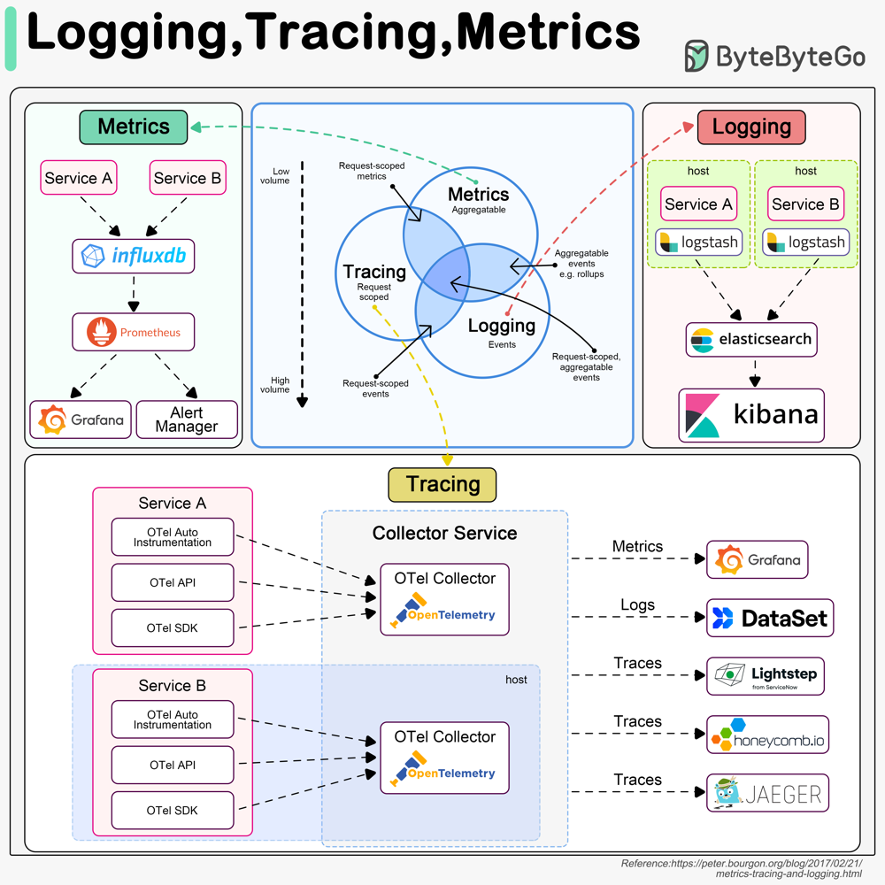

# Observabilidad en Sistemas Distribuidos basados en Microservicios

## Introducción a la Observabilidad y su Importancia

La **observabilidad** es la capacidad de comprender el estado de un sistema a partir de sus datos de salida.

Su objetivo es que los equipos puedan **operar el sistema de forma fiable** y verificar el **cumplimiento de los objetivos de nivel de servicio (SLO/SLI)**, facilitando la detección proactiva de problemas y el análisis de causa raíz.

## Los Tres Pilares de la Observabilidad: Métricas, Logs y Trazas

Tradicionalmente se habla de tres pilares fundamentales para lograr la observabilidad en sistemas distribuidos. Cada pilar representa un tipo de datos de telemetría que aporta una perspectiva complementaria sobre el comportamiento del sistema:

* **métricas** para detectar tendencias y degradaciones
* **logs** para entender qué ocurrió con detalle
* **trazas** para localizar dónde se consume el tiempo y cómo se encadenan las dependencias en un flujo distribuido. 

Regla práctica: **métricas** te indican *que hay un problema*, **trazas** suelen decirte *dónde está*, y **logs** te permiten confirmar *qué pasó* con el máximo detalle. 

| Pilar | Qué | Cuándo | Ejemplos |
|------|-----|--------|----------|
| **Métricas** | “¿Va bien o va mal?” | Detección temprana, alerting, capacidad | latencia p95/p99, error rate, RPS, saturación |
| **Logs** | “¿Qué pasó exactamente?” | Diagnóstico, auditoría, análisis forense | errores con stacktrace, eventos de negocio |
| **Trazas** | “¿Dónde se fue el tiempo y quién llamó a quién?” | Cuellos de botella, dependencias, RCA | spans por servicio, latencias por dependencia |

El ecosistema de aplicaciones, así como la progagación de datos se refleja en el siguiente diagrama:

## Pilar 1 — Métricas

### Qué es
Las métricas son valores numéricos que se registran de forma continua para entender cómo se comporta un sistema a lo largo del tiempo. Por ejemplo, cuánto tarda en responder, cuántos errores devuelve o cuánta CPU y memoria consume. En lugar de ser eventos sueltos, quedan guardadas como una serie temporal de valores, lo que permite consultarlas y agregarlas (sumar, promediar, agrupar por servicio, etc.) de forma eficiente para analizar la evolución y gestionar el sistema en producción: detectar degradaciones, observar patrones, planificar capacidad y automatizar alertas.

Son el punto de entrada típico para responder a “¿va bien o va mal?” y decidir dónde investigar con más detalle (trazas/logs) basándonos en:
* latencia
* errores
* recursos
* capacidad
* alertas

### [Buenas Pŕacticas](./metricas/metricas-buenas-practicas.md)

### [Antipatrones](./metricas/metricas-antipatrones.md)

### Herramientas / implementación típica (generación de métricas)

- **Micrometer (JVM/Spring)**: API de instrumentación; aporta métricas estándar (HTTP, JVM) y permite métricas de negocio. [Más aquí](./metricas/metricas-micrometer.md)
- **OpenTelemetry Metrics**: estándar multi-lenguaje para instrumentación; exportación vía OTLP.
- **Exposición**:
  - Formato Prometheus (endpoint HTTP) o exportación OTLP a un collector.
  - En Spring Boot: Actuator + registry correspondiente (p. ej. Prometheus registry).

### Deep-dive Métricas

- [Fundamentos](./metricas-fundamentos.md)
- [Tooling](./metricas-tooling.md)

Logs (Registro de Eventos)

Los logs son registros inmutables, con marca de tiempo, de eventos discretos ocurridos en la aplicación o sistema. Cada log suele contener un mensaje descriptivo y detalles de contexto sobre algo que ocurrió (por ejemplo: "Usuario X inició sesión", "Error de conexión a base de datos", etc.). A diferencia de las métricas (más cuantitativas y agregadas), los logs entregan la historia completa y granular de lo que pasa en el sistema, paso a paso. Son valiosos para el diagnóstico forense y la depuración, ya que proporcionan todo el contexto y secuencia de eventos que llevaron a una determinada condición.

Buenas prácticas: en una arquitectura de microservicios es imprescindible implementar un logging estructurado y centralizado. Estructurado significa que los logs se formatean en un formato parseable (ej. JSON), incluyendo campos clave como timestamp, nivel de severidad, identificador de la instancia/servicio y, muy importante, identificadores de correlación (por ejemplo un ID de petición o trace ID). Inyectar en cada log el identificador único de la solicitud actual, así como datos de contexto (ID de usuario, etc.), permite luego correlacionar logs a través de múltiples servicios y reconstruir la secuencia completa de una transacción. Centralizado implica que los logs de todos los microservicios se envíen a un sistema común de almacenamiento y búsqueda, en lugar de quedarse aislados en cada instancia. El patrón de Centralized Logging recomienda utilizar agentes (como Filebeat, Fluentd o Logstash) para recopilar logs desde cada contenedor/host y enviarlos a una base central. Soluciones típicas incluyen el stack ELK/Elastic Stack (Elasticsearch + Logstash + Kibana) o alternativas como Grafana Loki (sistema optimizado de logs indexados por etiquetas) o servicios cloud tipo Elastic Cloud, Splunk, Graylog, etc. En el almacenamiento central, los logs se indexan para permitir búsquedas rápidas por diversos campos (por ej. buscar todos los logs de nivel “ERROR” relacionados con la order_id 1234 en un rango de tiempo dado).

Es recomendable definir un esquema de logging consistente entre todos los servicios (mismos campos para información común como IDs de petición, formato de timestamp, etc.), de forma que al hacer búsquedas podamos correlacionar fácilmente. También se deben gestionar los niveles de log (DEBUG, INFO, WARN, ERROR) con criterio: en producción normalmente se evita DEBUG verbose, manteniendo INFO para hitos importantes, WARN/ERROR para anomalías. Una práctica útil es agregar contexto transaccional en logs de ciertos flujos, por ejemplo: todos los logs generados durante el procesamiento de una misma orden de compra contengan el mismo order_id o trace_id. Así, ante un problema, podemos filtrar los logs de ese trace_id en el visor central y tener toda la narración. Otra buena práctica es implementar rotación y retención de logs: dado que su volumen puede ser muy alto (especialmente en sistemas de alto tráfico), conviene eliminar o archivar logs antiguos (por ej., conservar 7 o 15 días en línea y luego almacenar comprimidos fuera). Asimismo, los logs pueden generar alertas: por ejemplo, un sistema central puede desencadenar una alerta si aparecen mensajes de error críticos o patrones específicos (esto puede hacerse con alertas en Kibana, o enviando ciertos eventos al sistema de monitoreo).

En resumen, los logs ofrecen la visión de detalle necesaria para diagnosticar problemas finos. Un caso de uso típico es investigar un error complejo: gracias a los logs centralizados, podemos seguir el rastro de la petición a través de los servicios y encontrar dónde falló exactamente. Herramientas como Elastic Stack y Splunk brindan capacidades de búsqueda potente (regexp, agregaciones) y visualización de logs, mientras que soluciones más nuevas como Loki favorecen la eficiencia en costos (almacena solo metadatos) a cambio de búsquedas de texto más lentas. Es importante elegir la solución de logging en función del volumen de datos y requisitos de análisis: por ejemplo, Elasticsearch ofrece búsquedas full-text muy rápidas pero consume muchos recursos en indexación, mientras Loki es liviano en recursos pero hace búsquedas más secuenciales (adecuado si se prioriza costo y se tienen buenos labels). Sea cual sea la herramienta, una estrategia de logging consistente (estructura, centralización, rotación) es clave para mantener la observabilidad en un ecosistema de microservicios.

Trazas Distribuidas (Distributed Tracing)

Las trazas son registros que capturan el recorrido completo de una solicitud o transacción a través de los múltiples servicios que intervienen en su procesamiento. Una traza distribuida se compone de spans (fragmentos de la operación en cada servicio) encadenados mediante identificadores únicos, de modo que se puede reconstruir la secuencia exacta de llamadas: desde la entrada (por ejemplo una API gateway o frontend) pasando por cada microservicio y base de datos, hasta la respuesta final al usuario. Este pilar de la observabilidad provee visibilidad de extremo a extremo en sistemas distribuidos, permitiendo identificar dónde se producen demoras, cuellos de botella o fallos en un flujo complejo que involucra varias piezas.

Buenas prácticas: implementar trazabilidad distribuida requiere instrumentar los servicios para que generen IDs de traza y los propaguen en todas las llamadas entre servicios. Al inicio de una petición (por ejemplo, cuando un usuario hace una petición HTTP al sistema), se genera un Trace ID único. Ese identificador viaja con la solicitud (por cabeceras HTTP como Traceparent, metadatos de mensajes, etc.) hacia cada microservicio posterior. Cada servicio, al procesar la petición, registra un span (segmento de traza) con ese ID común, e idealmente también un ID de span propio y de su padre (parent span). De esta forma, todos los eventos dispersos quedan encadenados bajo el mismo rastro. Es crucial asegurar la propagación de contexto entre servicios: las librerías o middlewares deben pasar las cabeceras de tracing en llamadas HTTP, gRPC, colas de mensajes, etc., para no romper la cadena. Estándares abiertos como W3C Trace Context definen cómo serializar estos identificadores en distintos protocolos. Si un servicio se olvida de pasar el contexto, la traza se corta allí, perdiendo visibilidad.

Además de propagar los IDs, cada servicio debe instrumentarse para reportar spans con información útil: nombre de la operación (por ejemplo "GET /api/orden"), timestamps de inicio y fin (para medir la duración), etiquetas relevantes (ej. user_id=123, db_cluster=users-db) y log de eventos o errores ocurridos durante ese span. Herramientas modernas como OpenTelemetry facilitan esta instrumentación, ofreciendo SDKs para múltiples lenguajes que automáticamente generan spans para frameworks web, llamadas HTTP, accesos a base de datos, etc., reduciendo el esfuerzo manual. OpenTelemetry actúa como un estándar unificado para recopilar métricas, logs y trazas, permitiendo exportar las trazas a sistemas de análisis como Jaeger o Zipkin. Se recomienda comenzar la instrumentación desde el desarrollo del sistema (diseñar los servicios ya con hooks de tracing), pues agregarlo a posteriori en un entorno distribuido grande puede ser engorroso.

Una vez que se recopilan, las trazas se envían a un backend de trazabilidad (por ejemplo, Jaeger, Zipkin, Tempo u otros). Estos sistemas almacenan las trazas (muchas veces de forma muestreada para no abrumar con cada petición en entornos de altísimo tráfico) y ofrecen interfaces para visualizarlas cronológicamente. Ver una traza típica en Jaeger, por ejemplo, nos muestra un diagrama de barras de cada microservicio involucrado y cuánto tiempo tomó cada uno en atender la petición. Esto es extremadamente útil para detectar, por ejemplo, que el servicio de pagos añadió 500 ms de latencia inesperada, o que hubo un timeout en la llamada del servicio A al B. También ayuda a mapear dependencias entre servicios: las trazas revelan la topología real de llamadas en producción, que a veces difiere de la imaginada.

Ejemplo: imaginemos una aplicación de comercio electrónico donde al confirmar una compra se involucran varios servicios (carrito, pagos, inventario, notificaciones). Si una orden está tardando demasiado, las trazas distribuidas permitirían ver quizás que el servicio de pagos fue llamado tres veces (reintentos) y cada llamada tomó 2 segundos esperando respuesta de un proveedor externo. Esa información contextual es casi imposible de obtener solo con métricas agregadas. Con tracing, no solo vemos el síntoma (latencia alta) sino dónde se fue el tiempo dentro del flujo. Además, combinando trazas con logs, un ingeniero puede saltar desde una traza en Jaeger al detalle del log de error exacto en el servicio problemático, siempre que comparten IDs de correlación.

Cabe mencionar que una consideración importante es el muestreo (sampling): grabar todas las trazas de todos los requests puede ser costoso en términos de almacenamiento y procesamiento. En la práctica, se suelen muestrear un porcentaje (por ejemplo 1% de las peticiones) o ciertas peticiones lentas o con error. Otra opción es el adaptive sampling que ajusta la tasa según la carga. Lo importante es que, incluso con muestreo, la infraestructura de tracing esté siempre activa para al menos una porción representativa de tráfico, de forma que cuando ocurre algo anómalo haya alta probabilidad de tener una traza registrada del evento.

En resumen, las trazas distribuidas proporcionan la visión correlacionada de flujo en sistemas distribuidos: complementan a los logs y métricas permitiendo entender el contexto temporal y causal de cada transacción. Implementar correctamente el tracing (con Trace IDs propagados, spans significativos e integridad de datos) es hoy considerado una práctica esencial para observabilidad en microservicios. Herramientas como Jaeger (open source, parte de CNCF) o servicios de APM comerciales (New Relic, Datadog, etc., que ofrecen tracing integrado) son utilizadas para este fin. Un sistema observable ideal correlaciona automáticamente métricas, logs y trazas: por ejemplo, cuando vemos una métrica de error elevada, podemos pinchar en un dashboard para ver las trazas de las transacciones que fallaron y luego ver los logs detallados de una en particular. Esta integración de pilares multiplica la capacidad de diagnóstico de los equipos.

Alertas, Dashboards y Paneles: De la Telemetría a la Acción

Una vez que se tienen métricas, logs y trazas recolectados, el siguiente paso de la observabilidad es traducir los datos en información accionable. Aquí es donde entran en juego las alertas y los dashboards (paneles de visualización), elementos clave para la acción operativa.

Alertas: Son notificaciones automáticas generadas por el sistema de monitoreo/observabilidad al detectarse ciertas condiciones anómalas o umbrales críticos. Una buena práctica es basar las alertas en aquellos indicadores que reflejan problemas que requieren intervención humana inmediata. Por ejemplo, si un servicio crítico supera un 5% de errores o si la latencia medianamente se triplica, una alerta debería dispararse. Las alertas suelen configurarse sobre métricas (p. ej., “dispara alerta si el 95º percentil de latencia > 500ms durante 5 minutos” o “si el número de instancias disponibles < 2”). También pueden derivarse de logs (p. ej., “si aparece un mensaje de ‘out of memory’ en logs”) o de la ausencia de cierta señal (heartbeat perdido). Es esencial que las alertas estén bien calibradas para evitar falsos positivos o ruido excesivo (alert fatigue). En entornos observables maduros, las alertas se alinean con los SLOs (ver siguiente sección): por ejemplo, una alerta puede indicar que se está por violar el objetivo de disponibilidad o de tasa de errores. Herramientas como Alertmanager de Prometheus, el sistema de alertas de Grafana, o los servicios integrados en plataformas como Datadog/New Relic, envían notificaciones por canales como email, SMS, Slack, PagerDuty, etc., asegurando que el equipo de guardia se entere de los problemas críticos en tiempo y forma. Un buen diseño de observabilidad incluye también runbooks asociados a alertas: cada alerta debería venir con una descripción clara y posiblemente un enlace a un procedimiento o dashboard que ayude a diagnosticar el problema señalado.

Dashboards o paneles de control: Son vistas gráficas y personalizadas que presentan las métricas y otra telemetría de forma organizada y fácilmente digerible. Los dashboards permiten a los equipos visualizar el estado del sistema de un vistazo y explorar tendencias históricas. Una práctica recomendada es construir dashboards específicos por servicio o por funcionalidad, mostrando sus KPIs principales (por ejemplo, un panel del Servicio de Autenticación con gráficos de login exitoso vs fallido, latencia de autenticación, consumo de CPU/memoria, etc.). También existen dashboards de nivel más alto, por ejemplo uno de overview de todo el sistema mostrando un mapa de servicios y sus estados, o dashboards enfocados en cierta métrica global (como el rendimiento de base de datos, colas, etc.). Herramientas populares para dashboards incluyen Grafana (muy usada junto con Prometheus y Loki), Kibana (para visualizaciones de Elastic Stack), y soluciones comerciales con sus propias interfaces. Un buen dashboard equilibra información resumida vs. posibilidad de detalle: suele mostrar indicadores generales (por ej. tasas de error globales) con la capacidad de profundizar filtrando por servicio, región, etc. Otra buena práctica es incorporar en los paneles indicadores de comparación (versus día anterior, semana anterior) para distinguir rápidamente si un pico es anómalo o parte de un patrón esperado (por ejemplo, tráfico elevado cada lunes a cierta hora). En entornos de operación 24/7, los dashboards suelen estar visibles en pantallas grandes para el NOC o el equipo SRE, mostrando continuamente el estado de salud. Además, tras incidentes, los dashboards ayudan a hacer post-mortems analizando cómo se comportaron las métricas antes, durante y después del problema.

Paneles de negocio o experiencia de usuario: Cabe destacar que la observabilidad no solo sirve para métricas técnicas, sino también para monitorizar la experiencia del usuario final. Por ejemplo, dashboards de experiencia digital (DEM - Digital Experience Monitoring) pueden incluir métricas como Core Web Vitals en una aplicación web, tiempos de carga percibidos por usuarios, tasas de conversión, etc. Esto permite alinear operaciones con objetivos de negocio (no solo ver CPU en 90%, sino entender que la página de checkout está lenta y eso afecta ventas). En la práctica, empresas han consolidado múltiples herramientas en plataformas unificadas para tener en un solo lugar tanto la telemetría técnica como indicadores de negocio, reduciendo el tiempo de diagnóstico y mejorando MTTR.

En conjunto, alertas y dashboards conforman el sistema nervioso operativo: las alertas son las señales de dolor (avisan dónde atender ya mismo) y los dashboards son los sentidos y memoria (permiten evaluar el estado general y profundizar en análisis). Un sistema observable efectivo requiere diseñar ambos con cuidado. Por ejemplo, buenas prácticas de dashboards incluyen: no sobrecargar con gráficos innecesarios, resaltar métricas de SLI/SLO, usar codificación de colores para estados (verde/amarillo/rojo), y proveer contexto (descripciones, anotaciones de despliegues en el tiempo). Para alertas, se recomienda probarlas frecuentemente (ej.: simular una caída para ver si la alerta se dispara) y revisarlas en retrospectivas de incidentes para ajustar sensibilidad o agregar las que falten. En suma, la incorporación de alertas efectivas y paneles visuales cierra el círculo de la observabilidad, pasando de datos recolectados a acciones concretas: detección de incidentes, respuesta más rápida y toma de decisiones informada en tiempo real.

SLIs, SLOs y SLAs: Midiendo la Fiabilidad de forma Objetiva

En el contexto de la fiabilidad del servicio han surgido tres conceptos fundamentales que se relacionan estrechamente con la observabilidad: SLI (Service Level Indicator), SLO (Service Level Objective) y SLA (Service Level Agreement). Estos términos provienen del mundo de la Site Reliability Engineering (SRE) y definen un marco para medir y gestionar la calidad del servicio de forma cuantitativa.

Service Level Indicator (SLI): Es un indicador de nivel de servicio, es decir, una métrica cuantitativa específica que mide un aspecto de la calidad o fiabilidad desde la perspectiva del usuario. En pocas palabras, un SLI es aquello que decidimos medir para saber qué tal lo estamos haciendo. Ejemplos comunes de SLIs son: la latencia de respuesta (ej. el percentil 99 de tiempo de respuesta de una API), la tasa de errores (p. ej. porcentaje de respuestas HTTP 5xx en un servicio), la disponibilidad (uptime) durante un periodo, o throughput (peticiones procesadas por segundo). Lo crucial es que el SLI refleje la experiencia real del usuario. Por ejemplo, medir la latencia en el 99º percentil de una API de pagos tiene sentido porque los usuarios notan si las transacciones son lentas; en cambio, medir el uso de CPU del servidor como SLI no es directamente visible para el cliente. Elegir buenos SLIs implica comprender qué métricas importan al nivel de servicio ofrecido (a veces se habla de “Señales de Oro” o Golden Signals, que suelen ser latencia, errores, tráfico y saturación, como se mencionó antes). Técnicamente, un SLI se calcula a partir de los datos recopilados por la plataforma de observabilidad; por ejemplo, el SLI de disponibilidad podría definirse como % de minutos en que el servicio respondió exitosamente al menos al 99% de las peticiones.

Service Level Objective (SLO): Es un objetivo o meta cuantitativa que establecemos sobre uno o varios SLIs. En otras palabras, es el nivel de servicio que nos comprometemos (internamente) a alcanzar para ese indicador. Un SLO siempre incluye un valor o umbral y un período de tiempo. Por ejemplo: “el 99.9% de las solicitudes a la API de pedidos deben tener una latencia menor a 300 ms en una ventana de 30 días”. Ese es un SLO concreto sobre el SLI de latencia. Otro ejemplo: “tasa de errores inferior al 0.1% semanal”. Los SLOs se suelen fijar equilibrando las expectativas del usuario/negocio con las capacidades técnicas; deben ser realistas pero exigentes. Un punto importante es que los SLOs son típicamente objetivos internos del equipo o empresa, no compromisos públicos (aunque a veces se comparten con clientes de manera informal para transparencia). Los SLOs guían las decisiones operativas: si un SLO está en peligro de incumplirse, el equipo de SRE/DevOps puede desencadenar acciones como parar lanzamientos (entra en juego el concepto de Error Budget, ver abajo) y dedicar tiempo a robustez en vez de nuevas características. Por ejemplo, Google SRE popularizó la idea de que si tu SLO de disponibilidad es 99.9%, entonces aceptas hasta 0.1% de indisponibilidad: ese margen es el presupuesto de error. Si lo “gastaste” (tu servicio estuvo caído 0.1% del tiempo este mes), no puedes permitir más caídas en lo que resta del periodo. Los SLOs bien definidos se centran en la experiencia de usuario: por ejemplo un SLO de “tiempo de carga de página <2s para el 95% de usuarios diarios” alinea directamente la operación con la satisfacción del cliente. Para hacer tracking de SLOs, muchas empresas construyen dashboards especiales de SLO y alertas asociadas (por ejemplo, alertar si en los últimos 24h el desempeño sugiere que el objetivo mensual puede fallar). Herramientas como New Relic, Datadog o la propia Grafana (con plugins como Grafana SLO) permiten gestionar SLOs y error budgets en sus interfaces. En definitiva, un SLO convierte métricas en compromisos medibles que enfocan al equipo en lo que importa: “lo que no se mide, no se puede mejorar”, y los SLOs ponen esa meta clara.

Service Level Agreement (SLA): Es un acuerdo de nivel de servicio contractual, típicamente un compromiso formal (y a menudo legal) entre un proveedor de servicio y sus clientes. Un SLA normalmente incluye uno o varios SLOs como garantía, y estipula consecuencias si no se cumplen (por ejemplo, compensaciones, créditos, penalizaciones). Por ejemplo, un proveedor cloud puede tener un SLA de “disponibilidad 99.99% anual” en su servicio; si cae por debajo (más de ~52 minutos de inactividad al año), el cliente tiene derecho a recibir créditos en la factura. Los SLA suelen expresarse en términos “duros” y suelen ser ligeramente menos exigentes que los SLOs internos: es común que una empresa tenga SLO interno de 99.9% pero ofrezca un SLA de 99.5% a clientes, reservando un margen para no incurrir en violaciones. La gestión de SLAs es más del ámbito contractual y de negocio, pero se apoya en la observabilidad para tener los datos que demuestren su cumplimiento. Es importante diferenciar que no todos los SLO se elevan a SLA: uno escoge qué objetivos promete a los clientes de manera formal. Muchos SLOs son simplemente internos para mantener estándares de calidad sin mediar contrato. Sin embargo, para servicios críticos (ej. APIs de pago, plataformas SaaS), los SLA públicos son un elemento de confianza comercial. Asegurar los SLA depende de la capacidad de monitorizar continuamente los SLI relacionados y producir informes (reportes de disponibilidad, etc.). La observabilidad bien implementada facilita enormemente esto, pues se puede automatizar la verificación del nivel de servicio alcanzado en el periodo y hasta brindar tableros en vivo a los clientes mostrando, por ejemplo, uptime mensual actual versus garantizado.

En conjunto, SLI, SLO y SLA proporcionan un lenguaje común entre equipos técnicos y el negocio para hablar de fiabilidad y rendimiento de forma cuantitativa. Por ejemplo, un equipo de desarrollo puede decir: “Nuestro SLI de tasa de error es 0.2% y excede el SLO de 0.1%, así que estamos gastando el presupuesto de error; debemos pausar lanzamientos hasta volver a estar dentro de objetivo”. Este enfoque impulsa una cultura de ingeniería orientada a objetivos claros de calidad. Y la observabilidad es la base que hace posible medir los SLIs correctamente y reaccionar en tiempo real al estado de los SLOs.

Error Budgets: Vale la pena mencionar brevemente este concepto asociado. El presupuesto de error es, como insinuamos, la tolerancia de falla que queda disponible dado un SLO. Si el SLO es 99% (de disponibilidad, por ejemplo), el 1% es el presupuesto de tiempo de inactividad permitido. Ese presupuesto se gasta cuando ocurren incidentes. El concepto de error budget se usa para equilibrar estabilidad vs cambios: mientras haya presupuesto disponible, se puede seguir implementando cambios/features; si se agota, se prioriza la estabilidad sobre nuevas implementaciones. Esto cierra el círculo: la observabilidad mide continuamente dónde estamos respecto al SLO, lo compara contra el error budget y sirve para tomar decisiones de gestión. En última instancia, SLI/SLO/SLA convierten la observabilidad en un instrumento de gestión proactiva de la fiabilidad, asegurando que la experiencia del usuario cumpla ciertos estándares definidos y que los equipos conozcan claramente cuáles son.

Diseñando Sistemas Observables desde el Inicio

Al construir sistemas distribuidos basados en microservicios, es altamente recomendable diseñar la observabilidad desde la concepción de la arquitectura, en lugar de intentar añadirla después como un parche. Aquí recopilamos recomendaciones prácticas para lograr sistemas “observables por diseño”, abordando aspectos de instrumentación, correlación y propagación de contexto, entre otros:

Instrumentación explícita del código y servicios: Asegúrate de que cada microservicio exponga las métricas y trazas necesarias desde el día uno. Esto implica incluir librerías de monitoreo (por ejemplo, el cliente de Prometheus, OpenTelemetry SDK, etc.) en cada servicio, y definir qué eventos o valores medir. Una práctica común es instrumentar puntos críticos de código: rutas de entrada/salida, llamadas a dependencias externas, operaciones en bases de datos, hilos consumidores de colas, etc. Por ejemplo, si tienes un servicio de pagos, instrumenta métricas como pagos_realizados_total, pagos_fallidos_total, latencia_procesar_pago_histograma, etc., además de trazar cada transacción de pago. La instrumentación también se aplica a infraestructura: habilita métricas en los balanceadores de carga, en la base de datos (usando exportadores), en los componentes de cola (Kafka, RabbitMQ suelen proveer métricas), etc. Todo elemento del sistema debe estar “telemetreado” en la medida de lo posible. Incluir esta instrumentación en la definición de “hecho” de cada historia de desarrollo (Definition of Done) es una buena práctica para no dejarlo de lado.

Correlación de eventos a través de servicios: En un sistema distribuido, es vital poder correlacionar la actividad entre múltiples servicios. Esto se logra implementando identificadores de correlación únicos para las transacciones. Genera un ID (UUID, número aleatorio, etc.) por cada solicitud o flujo de trabajo entrante al ecosistema, y propágalo en todas las llamadas internas entre microservicios. Ese identificador debe aparecer en todos los logs, trazas y posiblemente métricas relacionadas con esa transacción. Gracias a esto, cuando algo sale mal, puedes rastrear fácilmente la cadena completa de eventos filtrando por dicho ID. Por ejemplo, al atender una orden #123, los servicios de carrito, inventario, pago y notificación podrían todos incluir correlation_id=abc123 en sus logs; así, si hay un problema con esa orden, se puede recuperar todo el recorrido. Frameworks de microservicios a veces facilitan esta propagación de IDs de contexto (por ejemplo, pasando headers HTTP como X-Correlation-Id automáticamente). Si no, los desarrolladores deben incorporarlo manualmente en cada punto de integración. También es útil estandarizar el nombre de este campo (Correlation-Id, Trace-Id, etc.) en todo el sistema. Como vimos, las trazas distribuidas usan Trace IDs que cumplen este cometido de forma estructurada (permitiendo además medir tiempos entre spans). Incluso si no se implementa un sistema de tracing completo, al menos un simple correlation_id en los logs es invaluable. Según MentoresTech (2025) sobre patrones de observabilidad, el uso de Correlation IDs mejora la trazabilidad y depuración en entornos de alta concurrencia, permitiendo reconstruir una secuencia de eventos de un usuario a través de distintos servicios.

Propagación de contexto distribuido: Este punto se relaciona con el anterior y con el tracing. No solo se trata de pasar un identificador, sino potencialmente más información de contexto que puede ser útil para la observabilidad. La propagación de contexto consiste en adjuntar a cada solicitud datos adicionales que los siguientes servicios puedan leer. Por ejemplo, se puede propagar un token de autenticación de usuario para que todos los servicios sepan quién es el usuario; o un flag de debug para que ciertos servicios generen logs más verbosos solo para una petición específica. En observabilidad, el contexto típico es el de tracing (Trace ID + Span ID + muestreo), pero podría extenderse. Lo importante es diseñar los mecanismos para pasar información de forma transparente: en microservicios REST es a través de headers HTTP; en gRPC mediante metadata; en sistemas de colas, incluyendo campos en el mensaje, etc. Asegúrate de que las librerías de comunicación que uses no “rompan” los headers (algunos proxies requieren configuraciones para forwardear headers no estándar). Muchas veces, usar estándares open (W3C Trace Context, B3, etc.) facilita esto porque muchas herramientas ya los manejan automáticamente. Recuerda que una traza es tan completa como la propagación de contexto lo permita: basta que un servicio en medio no reenvíe los headers para perder visibilidad del resto de la cadena.

Uso de herramientas y estándares abiertos: Apoyarse en herramientas estandarizadas de observabilidad desde la arquitectura ahorra muchos dolores. Por ejemplo, adoptar OpenTelemetry como columna vertebral: en diseño se define que todos los servicios usarán el SDK de OTel para métricas/trazas/logs, enviando los datos a un collector central (otro componente que puede escalarse aparte). OpenTelemetry unifica formatos y evita lock-in con un proveedor, además de ser compatible con muchos backends (Prometheus, Jaeger, Zipkin, etc.). Otro estándar es OpenTracing (predecesor de OTel para trazas) o OpenMetrics (formato de métrica compatible con Prometheus). Diseñar con ellos significa que tu arquitectura no dependerá de un agente propietario en cada servicio, sino de componentes intercambiables. También piensa en el formato de logs de forma cross-language: por ejemplo, JSON Lines es un buen formato común.

Instrumentar también la experiencia cliente: Si tu sistema incluye componentes de frontend (apps web, móviles), considera la observabilidad end-to-end. Por ejemplo, insertar rastreo en la aplicación web (usando APIs como PerformanceTiming o librerías de RUM - Real User Monitoring) para medir cuánto tarda realmente una página en cargar en el navegador, o cuántos errores JS ocurren. Esas métricas de frontend (como tiempo al primer byte, tiempo de interacción, Core Web Vitals) complementan la visión de backend y ayudan a detectar si un problema proviene del servidor o del cliente. Herramientas como Google Analytics, New Relic Browser, Datadog RUM u open source como Web Vitals JS proveen esta telemetría. La clave es que en el diseño del sistema se contemple capturar la experiencia del usuario final como parte de la observabilidad general.

Consideraciones de performance de la instrumentación: Diseñar sistemas observables también implica tener en cuenta el costo de la telemetría. Cada métrica registrada, cada log escrito y cada span generado tiene un costo en CPU, IO o red. Es importante que la instrumentación esté optimizada para no degradar el rendimiento de la aplicación (lo último que se desea es que por monitorear, el sistema se vuelva lento). Usar niveles de muestreo, no loggear dentro de loops de alto volumen, y preferir métricas agregadas en vez de logs repetitivos en casos de altísima frecuencia son medidas sensatas. Por ejemplo, en lugar de escribir un log por cada request en un servicio de millones de RPS, se podría llevar un contador métrico e incrementar. Otro ejemplo: si tienes que loggear algo muy detallado, tal vez hazlo solo en entorno de prueba o cuando un header especial esté presente (logging on-demand). Los diseñadores de observabilidad deben decidir qué nivel de detalle es necesario y dónde, para no inundar de datos inútiles ni afectar la estabilidad.

Monitoreo de la propia infraestructura de observabilidad: Un punto a veces olvidado es que las propias herramientas de observabilidad (Prometheus, Elasticsearch, agentes) deben ser monitoreadas. Diseña tu sistema de forma que si, por ejemplo, el servidor de métricas está caído, eso mismo genere una alerta. La observabilidad no debe ser un single point of failure. Se recomienda desplegar componentes en alta disponibilidad cuando sea posible (ej., instancias replicadas de collectors de OpenTelemetry, clústeres de datos con redundancia, etc.) y tener planes de backpressure (¿qué pasa si los agentes no pueden enviar datos? Lo ideal es que el servicio observadi no se bloquee, sino que degrade silenciosamente, por ejemplo descartando trazas si el backend no responde).

En síntesis, diseñar un sistema observable implica integrar la recolección y correlación de datos en la arquitectura básica del sistema. Esto abarca desde decisiones de alto nivel (elegir stacks open vs propietarios, definir SLOs que guíen qué se mide) hasta detalles de implementación (pasar IDs de correlación en cada llamada, formato de logs consistente). La inversión en observabilidad desde el diseño paga dividendos enormes en la fase operativa: los problemas se detectan más rápido, es más sencillo escalar o depurar comportamientos emergentes, y en general se reduce la incertidumbre sobre el sistema en producción. En la era de microservicios y despliegues continuos, esta visibilidad built-in no es opcional sino necesaria para mantener la confiabilidad y velocidad simultáneamente.

Herramientas Comunes para la Observabilidad: Opciones, Pros y Contras

Existen numerosas herramientas en el ecosistema actual para implementar cada aspecto de la observabilidad (métricas, logs, trazas, visualización, alertas). A continuación, describiremos algunas de las más utilizadas – incluyendo soluciones open source reconocidas y también plataformas integrales – junto con sus ventajas y consideraciones (potenciales contras), para orientar la elección según las necesidades.

Prometheus (métricas): Prometheus es la herramienta open source estándar de facto para métricas en entornos cloud-native (proyecto graduado por la CNCF). Está diseñado para monitorización de sistemas distribuidos con un enfoque pull (Prometheus interroga a los endpoints de los servicios para recoger métricas) y almacenamiento local de series temporales. Ventajas: totalmente gratuito y comunitario, amplia integración (muchos exporters para recopilar métricas de prácticamente cualquier tecnología), potente lenguaje de consulta (PromQL) que permite desde agregaciones simples hasta cálculos complejos, integración nativa con Alertmanager para alertas, y fácil de desplegar (un binario único). Es ideal para instrumentar servicios en Kubernetes y ya hay muchos helm charts y configuraciones disponibles. Contras: Prometheus por sí solo almacena los datos en una única instancia (cada server es autosuficiente). Escalarlo para grandes volúmenes o retenciones largas requiere añadir componentes (federación, o proyectos complementarios como Thanos, Cortex o VictoriaMetrics). Otro contra es la gestión de alta cardinalidad: si se generan etiquetas con valores muy variables (por ejemplo, un label de usuario_id con millones de valores únicos), la memoria de Prometheus puede verse abrumada. Por ello, se necesita disciplina en qué se etiqueta. En entornos con muchísimos microservicios, se puede necesitar varios Prometheus federados. Aún así, su eficiencia y modelo mental (pull + time-series DB) lo hacen muy robusto. Su lenguaje de alertas permite codificar fácilmente condiciones de SLO (ej: porcentaje de errores en 5m). Caso de uso típico: métricas de infraestructura (CPU, RAM, latencias HTTP, etc.) graficadas en Grafana y con alertas vía Alertmanager. Prometheus destaca en monitorización de infraestructura y servicios backend. En caso de requerir alta disponibilidad, se configuran instancias redundantes scrapeando los mismos datos para no perder telemetría si una cae.

Grafana (visualización y alertas): Grafana es la plataforma open source líder para dashboards. Es muy versátil, ya que soporta múltiples fuentes de datos (Prometheus, InfluxDB, Elastic, CloudWatch, etc.) y permite construir paneles visuales altamente personalizables. Ventajas: interfaz web amigable, con gran variedad de gráficos, alerting integrado (desde la v8 en adelante Grafana permite definir alertas sobre las consultas de los paneles, consolidando la gestión de alertas en un solo lugar), amplio ecosistema de plugins y paneles prehechos (la comunidad comparte dashboards para muchas tecnologías). Grafana actúa como el hub unificador de la observabilidad: en una sola herramienta puedes ver métricas de Prometheus, logs de Loki, trazas de Tempo, datos de SQL, etc. Además tiene capacidades de annotations (marcar en gráficas cuándo hubo despliegues, incidentes, etc.). Contras: requiere tiempo de configuración para cada panel (aunque hay muchos ya hechos, igualmente hay que ajustarlos a tu sistema). Si bien Grafana es ligero, al conectar con muchas fuentes puede volverse complejo de mantener las credenciales, etc. Su sistema de alertas es poderoso pero relativamente nuevo comparado con soluciones dedicadas; para aprovecharlo al 100% se suele usar junto a Grafana Loki/Tempo de modo integrado. En comparación a herramientas comerciales, Grafana carece de ciertas características avanzadas (p.ej., detección automática de anómalos con ML, etc.), aunque su versión Enterprise añade algunas. Caso de uso típico: una instancia de Grafana desplegada en Kubernetes visualizando datos de Prometheus (por ejemplo panel de Kubernetes cluster, panel de métricas de aplicación) y enviando alertas a Slack cuando ciertos gráficos exceden umbrales. Grafana es casi omnipresente hoy en observabilidad por su capacidad de integrar todo en vistas personalizadas.

Elasticsearch / ELK Stack (logging y más): Elasticsearch es un motor de búsqueda y análisis de texto potente que, combinado con Logstash (pipeline ingestión) y Kibana (visualización), conforma la llamada ELK Stack (ahora también conocida como Elastic Stack). Es ampliamente usada para centralizar logs de aplicaciones. Ventajas: Elasticsearch ofrece indexación casi en tiempo real de grandes volúmenes de datos y consultas full-text muy rápidas, lo que permite buscar patrones o términos en millones de logs en segundos. Además soporta agregaciones, permitiendo por ejemplo contar cuántos errores de cada tipo ocurrieron. Es escalable de forma distribuida: se pueden desplegar múltiples nodos en cluster para almacenar terabytes de datos con replicación. Kibana proporciona una UI amigable para búsquedas, dashboards de logs, e incluso métricas (via X-Pack) y APM si se usan las soluciones de Elastic. En general, Elastic Stack es una solución integral: con Beats/Logstash se recogen datos de donde sea (logs, métricas, incluso datos de seguridad), se almacenan en Elasticsearch y se exploran en Kibana. Contras: El costo computacional: Elasticsearch es conocido por alto consumo de recursos (RAM/CPU) especialmente a medida que crece el cluster. Gestionar y tunear un cluster Elastic no es trivial (shards, manejo de índices, snapshots, etc.). Además, desde 2021 Elastic cambió su licencia, por lo que muchas empresas migraron a forks open source como OpenSearch (manteniendo compatibilidad). Otra contra es que Kibana, aunque muy capaz, tiene su propia lógica de consultas (Lucene Query) diferente a PromQL o SQL, sumando complejidad para los usuarios. A pesar de eso, para logging heavy-duty es difícil superar a Elastic en capacidades de búsqueda. Caso de uso típico: cluster ELK recibiendo vía Logstash o Beats los logs de cientos de microservicios, indexándolos con campos de timestamp, nivel, servicio, etc., y permitiendo a los devs buscar “ERROR” o correlacionar logs de una transacción. Elastic también se usa para métricas en algunos casos (Metricbeat) y hasta para tracing (APM Java agents), pero su fuerte es log y eventos. Si el volumen de logs es moderado o se tiene presupuesto para la infraestructura, ELK brinda mucha flexibilidad (por ejemplo, se puede aplicar pipelines de procesamiento: parsear JSON, hacer masking de datos sensibles, etc., antes de indexar). Comparado con alternativas, Elastic destaca en capacidad analítica pero a costa de complejidad operativa.

Grafana Loki (logging): Loki es una alternativa moderna para gestión de logs, creada por Grafana Labs, pensada para ambientes cloud-native y Kubernetes. Se diseñó con la idea de ser a los logs lo que Prometheus es a las métricas. Ventajas: Loki no indexa el contenido completo de los logs, solo indexa etiquetas (por ejemplo, etiquetas como aplicación, instancia, pod, etc.) y la marca de tiempo. Esto lo hace mucho más eficiente en almacenamiento y CPU que Elastic (que indexa todo el texto). Los logs en Loki se agrupan en streams por etiqueta y se almacenan en sistemas de archivos u object storage (S3, etc.), haciéndolo barato de escalar. Loki usa el mismo concepto de pull (con agentes promtail enviando logs) y un lenguaje de consulta similar a PromQL llamado LogQL, lo que resulta familiar a quienes usan Prometheus. Integración inmediata con Grafana (los dashboards Grafana pueden combinar métricas de Prometheus con logs de Loki fácilmente). Contras: Al no indexar el texto, buscar por contenido arbitrario en Loki es mucho más lento (hay que escanear los logs), salvo que primero filtres por etiquetas. Esto significa que si no tenías una etiqueta útil para lo que buscas, puede costar. Loki está más orientado a ver logs de una entidad conocida (p.ej. dame los logs del servicio X con id de petición Y). Para exploración ad-hoc de texto completo, Elastic es más potente. Otra limitación es que Loki aún es relativamente joven comparado con ELK; tiene menos features de análisis avanzado o de procesamiento en ingreso (aunque está mejorando). Caso de uso típico: entornos Kubernetes donde cada pod envía logs con promtail a Loki, etiquetados por namespace, pod, container, etc. Un ingeniero ve en Grafana que la métrica de error subió para el servicio Y, y puede cambiar al panel de logs de Loki filtrado por servicio Y y rango de tiempo para ver qué errores ocurrieron. Para la mayoría de análisis operativos, Loki funciona muy bien, consumiendo menos que Elastic. Pero si se requiere buscar texto en 100 millones de logs históricos sin saber en qué servicio ocurrió, Loki no será tan eficiente. En resumen, Loki prioriza costo y simplicidad a cambio de sacrificar algo de poder de búsqueda full-text.

Jaeger (tracing): Jaeger es un sistema open source (incubado en CNCF) para trazabilidad distribuida, inicialmente desarrollado por Uber. Ventajas: Permite recolectar trazas de múltiples aplicaciones instrumentadas (compatible con OpenTracing, y ahora con OpenTelemetry), almacenarlas y visualizarlas en su UI. Jaeger soporta varios backends de almacenamiento (desde en memoria para dev, hasta Cassandra, Elasticsearch, Badger, etc.) para guardar las spans. Ofrece búsqueda de trazas por diversos filtros (servicio, operación, duración mínima, etiquetas), lo cual ayuda a encontrar por ejemplo “trazas de peticiones lentas > 1s”. Tiene también vistas de mapa de dependencias entre servicios basadas en las trazas reportadas. Al ser open source, uno puede desplegar Jaeger on-premise sin licenciamiento, integrarlo con Kubernetes fácilmente (hay un operator). Contras: Jaeger, por sí solo, requiere manejar la infraestructura de almacenamiento para las trazas si se quieren conservar muchas y de largo periodo. Por ejemplo, almacenar trazas en Elasticsearch puede ser costoso (aunque permite indexar para buscar). Las consultas de trazas pueden ser intensivas si el dataset es grande. En general, el tracing produce muchísimos datos, por lo que Jaeger se suele acompañar de políticas de muestreo agresivas o retención corta (unos días). En comparación con soluciones APM comerciales, Jaeger es más básico en funcionalidad (no tiene por ejemplo detección automática de anomalías en trazas, o análisis de impacto de deploy). Su UI aunque útil es espartana, quizás menos amigable que la de Zipkin o servicios pagos. Además, Jaeger originalmente estaba muy ligado a OpenTracing; con la transición a OpenTelemetry, hay que asegurarse de usar los Collectors adecuados para enviarlo a Jaeger en formato OTLP. Caso de uso típico: un cluster Jaeger desplegado en Kubernetes, con un agente sidecar en cada pod o un collector central a donde las apps (instrumentadas con OpenTelemetry SDK) envían spans. Los desarrolladores pueden entrar a la UI de Jaeger, seleccionar el servicio “Checkout” y ver una lista de trazas recientes, ordenadas por duración, para analizar las más lentas. Descubren quizás que la llamada al servicio de recomendaciones dentro de checkout está tardando 500ms. Con esa info, van al equipo correspondiente para optimizar. Jaeger facilita esa visibilidad end-to-end. En producción, suele integrarse con sistemas de muestreo (por ejemplo, mantener 100% de trazas de errores pero solo 1% de trazas exitosas). Una ventaja de Jaeger es su compatibilidad: cualquier app que use OpenTracing (Jaeger cliente, Zipkin libs, etc.) o que envíe via OpenTelemetry Collector se puede volcar ahí. En la categoría de tracing, Zipkin es otra herramienta open source popular, con funcionalidad similar (fue pionera inspirada en Google Dapper). Zipkin es más sencillo de operar pero menos flexible en backend (usa principalmente Cassandra o Elasticsearch). Concurrencia con herramientas comerciales: servicios como New Relic, AppDynamics, Dynatrace o Datadog APM ofrecen tracing con más análisis automático, pero a cambio de costo. Si la organización prefiere open source, Jaeger es una gran opción a considerar por su comunidad activa y constante evolución.

OpenTelemetry (estándar de telemetría): No es una herramienta “una” sino un conjunto de herramientas y especificaciones que merece mención aparte. OpenTelemetry (OTel) es un proyecto CNCF que unificó OpenTracing y OpenCensus, proporcionando un marco estándar para instrumentación de aplicaciones en cuanto a métricas, logs y trazas. Ventajas: ofrece SDKs para múltiples lenguajes (Java, Python, Go, .NET, etc.) que facilitan instrumentar sin demasiado código (muchos frameworks tienen ya instrumentación automática). También provee un componente llamado Collector que puede recibir datos en múltiples protocolos (OTLP, Jaeger, Zipkin, Prometheus, etc.), procesarlos (añadir etiquetas, hacer sampling, agregaciones) y exportarlos a diversos backends (Prometheus, Jaeger, Zipkin, Kafka, Elastic, etc.). Esto crea una capa de abstracción muy poderosa: puedes instrumentar tu app una vez con OTel, y decidir después enviar los datos a la herramienta X o Y, o incluso a varias a la vez, sin cambiar tu código. Contras: la complejidad de configuración. OpenTelemetry es joven y evolve rápido; a veces las versiones de SDK y Collector hay que sincronizarlas. Requiere gestionar otro componente (el Collector) aunque este es relativamente ligero y escalable. Además, aprender la configuración (pipelines, exporters, samplers) tiene su curva. Pero en general, las ventajas superan los contras si buscas consistencia. Muchas empresas adoptan OTel para evitar el vendor lock-in de agentes propietarios y para contribuir a la comunidad en la creación de instrumentaciones estandarizadas. Caso de uso: un microservicio en .NET usando OpenTelemetry SDK recoge métricas de ASP.NET Core automáticamente, trazas de todas las peticiones HTTP entrantes y salientes, y logs estructurados; lo envía al Collector local, el cual a su vez exporta métricas a Prometheus, trazas a Jaeger y logs a Loki. Todo con mínimos cambios en el código de la aplicación. Este tipo de despliegue integrado es lo que OTel busca facilitar.

Plataformas integrales (Datadog, New Relic, Splunk, etc.): Además de las herramientas open source mencionadas, existen suites comerciales todo-en-uno que ofrecen observabilidad unificada. Por ejemplo, Datadog proporciona monitoreo de infraestructura, APM (tracing), gestión de logs, synthetics (pruebas activas) y más, en una plataforma SaaS con agentes fáciles de instalar. New Relic ofrece un producto similar (NR One) que abarca desde métricas de infra a experiencia de usuario, con un lenguaje de consultas (NRQL) y dashboards integrados. Splunk comenzó en logs pero ahora con Splunk Observability Cloud cubre métricas (SignalFx), tracing (decayente) y RUM. Dynatrace, AppDynamics, etc., también compiten en este segmento. Ventajas: conveniencia – estas plataformas brindan out-of-the-box vistas y análisis avanzados, muchas incluyen ML para detectar anomalías, trazabilidad sin necesidad de configurar Jaeger, etc. Reducen la carga de mantener la infraestructura de observabilidad (lo hace el proveedor). Suelen tener muy buen soporte y guías. Contras: el costo suele ser elevado (se paga por host, por volumen de datos ingestado, etc.), lo que puede volverse prohibitivo a escala grande. También, cierto vendor lock-in – una vez que envías todos tus datos a un SaaS, migrar puede ser complejo (aunque OTel está estandarizando esto). Además, algunos ingenieros prefieren la flexibilidad de open source para personalizar completamente. Caso de uso típico: una startup que no quiere manejar su propio Prometheus/Elastic instala el agente de Datadog en sus servidores, empieza a ver gráficas y trazas en minutos en la web de Datadog, configura alertas con unos clics, y delega en la plataforma la disponibilidad de esos datos. Este enfoque acelera la implementación de observabilidad pero a cambio de una factura mensual. En organizaciones grandes, a veces conviven soluciones: por ejemplo logs en Splunk (por políticas corporativas) pero métricas en Prometheus/Grafana.

En la siguiente tabla resumimos las herramientas mencionadas con algunos pros/contras clave:

Prometheus: (+) Open source, amplio soporte comunidad, lenguaje poderoso; (–) almacenamiento local, requiere esfuerzo para HA y alta cardinalidad.

Grafana: (+) Unifica visualización multi-fuente, flexible, plugin ecosystem; (–) Configuración manual de paneles, sin análisis automatizado.

Elastic Stack: (+) Búsqueda log rápida, muy customizable, escalable distribuido; (–) Alto consumo recursos, administración compleja, licencia no 100% open (Elastic vs OpenSearch).

Loki: (+) Eficiente en costos, integración con Grafana, fácil para K8s; (–) Búsqueda texto lenta sin indexar, menos madura que Elastic, limitado para análisis ad-hoc extensivo.

Jaeger: (+) Tracing end-to-end open source, integrable con OTel, buena visualización dependencias; (–) Necesita infraestructura almacenamiento, UI básica, sin analítica avanzada incorporada.

OpenTelemetry: (+) Estándar unificado, evita lock-in, auto-instrumentación rica; (–) Configuración compleja, documentación en evolución, adopción implica cambio cultural.

Datadog/NewRelic/etc.: (+) Solución completa, rápida de implementar, insights con ML, soporte; (–) Costosa a gran escala, black-box (menos control), dependencia del proveedor.

La elección de herramientas dependerá de las prioridades de la organización: presupuesto vs. conveniencia, nivel de escala, experiencia del equipo, requisitos de privacidad (datos on-prem vs cloud), etc. En muchos casos se termina con un mix híbrido: por ejemplo, usar Prometheus+Grafana para métricas de infraestructura, pero enviar ciertos logs muy críticos a Splunk por requisitos de auditoría, o usar Jaeger internamente pero también un Datadog APM para ciertas apps legacy. Lo importante es mantener los estándares de instrumentación para no duplicar esfuerzos (por ej., usar OTel y luego exportar a múltiples destinos según haga falta).

Al implantar estas herramientas, es recomendable hacerlo de manera incremental: empezar quizá por centralizar logs, luego métricas de sistema, después incorporar tracing. Cada capa añadirá valor y permitirá afinar la siguiente. La curva de aprendizaje también se suaviza si se va paso a paso. Afortunadamente, la comunidad de observabilidad es muy activa y existen infinidad de recursos (blogs técnicos, documentación oficial, foros) para aprender mejores prácticas de cada herramienta.

Patrones de Arquitectura Observable: Mejores Prácticas, Antipatrones y Escalabilidad

Diseñar una arquitectura de microservicios observable no solo implica elegir herramientas, sino también aplicar ciertos patrones de diseño que facilitan la monitorización y evitar prácticas contraproducentes (antipatrones) que puedan entorpecer la visibilidad o la respuesta a incidentes. A continuación, repasamos algunos patrones comunes, así como antipatrones a evitar, junto con consideraciones de escalabilidad:

Patrones clave de observabilidad:

Centralized Logging (Registro centralizado): Como mencionamos, centralizar los logs de todos los servicios en una ubicación (o sistema) única es un patrón fundamental. Esto suele implementarse mediante agregadores o forwarders que recogen logs de cada instancia y los envían a un cluster central (ELK, Loki, etc.). Beneficios: permite búsquedas globales, correlación de eventos entre servicios y análisis forense unificado. Este patrón es prácticamente un requisito en microservicios, ya que confiar en revisar logs localmente en cada contenedor es inviable. Herramientas como Elastic, Fluentd, Loki implementan este patrón con facilidad para Kubernetes. Un ejemplo práctico: en un flujo de solicitud que pasa por 5 microservicios, el logging centralizado permite rastrear la solicitud a través de todos ellos y encontrar rápidamente el origen del problema en caso de error.

Distributed Tracing (Trazabilidad distribuida): Ya cubierto extensamente, es un patrón esencial: asignar identificadores de traza únicos y propagarlo por cada servicio para obtener un historial detallado de cada solicitud. Beneficios: visibilidad de extremo a extremo, identificación de cuellos de botella, medición de latencias por segmento. Este patrón se apoya en herramientas como Jaeger/Zipkin y frameworks de tracing. Ejemplo: Para una transacción de pago que involucra 4 servicios, la trazabilidad distribuida permite visualizar que, por ejemplo, el 80% del tiempo total se consumió en el servicio de validación de tarjeta (revelando dónde optimizar). Hoy en día, este patrón es altamente recomendado en cualquier arquitectura de microservicios que tenga más de unos pocos servicios, pues la complejidad crece exponencialmente y el tracing es la brújula en ese laberinto.

Metrics & Monitoring (Métricas y Monitoreo) como primera clase: Consiste en diseñar los microservicios para exponer métricas de salud y rendimiento desde un inicio (por ejemplo, endpoints /metrics o integraciones con agentes), y configurar sistemas de monitoreo que recolecten y supervisen esas métricas constantemente. Beneficios: detección temprana de anomalías, capacidad de reacción proactiva. Este patrón incluye también implementar health checks (endpoints /healthz o similares) para que tanto orquestadores (Kubernetes liveness/readiness probes) como dashboards muestren si un servicio está operativo. Por ejemplo, un patrón complementario es Health Endpoint: cada servicio expone un indicador sencillo de si sus dependencias principales están bien; el orquestador puede reiniciar el contenedor si este check falla repetidamente. Todo esto entra en métricas: un servicio puede exponer up=1 si está sano o up=0 si detecta fallos internos, de modo que Prometheus al capturarlo activa alarmas si up=0.

Correlation IDs (Identificadores de correlación): Como ya se discutió, es un patrón donde a cada interacción se le asigna un ID único que viaja por todos los componentes. Beneficios: faculta la reconstrucción de flujos en entornos altamente concurrentes, facilitando depuración y trazabilidad incluso cuando el tracing formal no está presente. Es un patrón relativamente simple de implementar (generar un UUID al inicio de la cadena y pasarlo en headers o mensajes), pero de enorme impacto en la capacidad de diagnóstico. Comparte propósito con trace IDs; de hecho, muchas veces el trace_id del sistema de tracing se utiliza también como correlation_id para logs. Este patrón es casi obligatorio para sistemas que manejan transacciones distribuidas, pedidos, etc., ya que sin él, conectar un evento en un servicio con el efecto en otro es manual y propenso a error.

Observability-driven Development (ODD): Si bien no es un patrón de arquitectura per se, es una filosofía que está ganando adopción: diseñar y desarrollar funcionalidades pensando en cómo serán observadas. Esto implica, por ejemplo, escribir event logs específicos para hitos de negocio (no solo logs técnicos), instrumentar contadores para eventos importantes (ej. “usuario se registró”), y en general hacer que cada nueva pieza venga con su propio conjunto de telemetría. Un antipatrón opuesto sería desarrollar todo primero y luego “ah, ahora agreguemos logs/metrics si da tiempo”. Practicar ODD mejora la calidad del software en producción, ya que los equipos piensan de antemano cómo sabrán si algo falla y qué indicadores de éxito tendrá una nueva feature. Por ejemplo, al crear un nuevo servicio de recomendaciones, el equipo define desde diseño métricas como recommendation_response_time o recommendations_served_count y las incorpora en el código junto con la funcionalidad principal.

Antipatrones a evitar:

Lack of Observability (falta de observabilidad) como anti-patrón general: Es paradójico pero uno de los anti-patrones más comunes es simplemente no invertir en observabilidad, operar a ciegas. En microservicios, esto se manifiesta en logging limitado (solo logs locales, sin estructura ni correlación), sin tracing, y métricas básicas o inexistentes. Este anti-patrón lleva a situaciones donde ante un incidente los ingenieros tardan muchísimo en identificar el problema, a veces recurriendo a habilitar logs debug “en caliente” o redeployar con más info, lo cual prolonga el downtime. La solución obvia es no caer en esto: desde el inicio, evitar tener servicios como cajas negras.

Alertas en exceso o mal calibradas: Otro anti-patrón es configurar demasiadas alertas o umbrales poco inteligentes, resultando en alert fatigue. Si todo envía alertas constantemente, el equipo las empezará a ignorar (como el “pastor mentiroso”). Por ejemplo, alertar por cada pico mínimo de CPU o cada pequeño timeout momentáneo genera ruido. También es anti-patrón alertar sobre métricas intermedias en lugar de síntomas reales de problemas. Mejores prácticas (lo contrario del anti-patrón) incluyen alertar solo por condiciones que requieren acción (p.ej. error rate sostenido alto, SLO violado, servicio caído) y evitar notificaciones redundantes. Las alertas deben consolidarse (no 50 mails por 50 microservicios caídos si en realidad todos dependen de uno solo que falló; mejor una alerta agregada).

Dashboards estáticos no utilizados: Tener multitud de dashboards predefinidos por plantilla que nadie mira es otro anti-patrón observado. Algunas organizaciones cargan tantos paneles “por tener observabilidad” que los equipos se confunden sobre cuál mirar, o los paneles muestran métricas irrelevantes. Dashboard Confusion se traduce en perder tiempo buscando la info importante entre gráficos inútiles. La solución es menos es más: cada dashboard debe tener un propósito claro y ser mantenido. Es preferible 5 dashboards críticos bien afinados que 50 que nadie entiende. Actualizar o retirar paneles obsoletos también es sano.

No relacionar la observabilidad con experiencias de usuario: Un anti-patrón sutil es enfocarse solo en métricas de sistemas internas y no en lo que percibe el cliente. Esto lleva a “todo verde” en monitoreo mientras el usuario tal vez sufre (porque, por ejemplo, la métrica de CPU está bien, pero resulta que un problema lógico impide compras y eso no estaba medido). Es crucial incluir SLIs orientados al usuario (tasa de solicitudes exitosas, tiempos de respuesta completos, etc.) en la observabilidad. De lo contrario, puedes cumplir todos tus dashboards técnicos y aun así fallar al negocio.

Coleccionar todos los datos indiscriminadamente: El opuesto de no observar nada, es otro anti-patrón: recopilar absolutamente todos los datos posibles sin estrategia. Si bien al inicio puede sonar bien (“guardemos todo por si acaso”), en la práctica genera un tsunami de datos que entierra los insights útiles y dispara costos. Ejemplo: loggear cada petición en detalle aunque sean millones por minuto, sin pensar si se usará. O tener 2000 métricas por servicio por defecto. Esto complica también la performance (sobrecarga los agentes, la red, etc.). La guía aquí es calidad sobre cantidad: instrumentar lo necesario y valioso, pero no cada variable trivial. Se puede comenzar con un conjunto básico de señales y ampliar conforme surjan necesidades reales de observación de cierto punto ciego. Además, implementar políticas de retención (no guardar todo eternamente) es necesario para mantener manejable el almacenamiento.

Escalabilidad de la solución de observabilidad:

La arquitectura observable debe también escalar a la par del sistema. Al agregar más microservicios o mayor volumen de transacciones, la plataforma de observabilidad debe adaptarse. Algunos aspectos a considerar:

Escalado de ingestión y almacenamiento: A medida que los sistemas crecen, los volúmenes de métricas (series), logs (MB/seg) y spans de trazas pueden crecer exponencialmente. Hay que diseñar la plataforma para escalar horizontalmente. Por ejemplo, desplegar múltiples instancias de Prometheus federadas o usar un backend remoto para long-term metrics (como Thanos) cuando se exceden ciertos límites. Para logs, quizás particionar por tipo o por equipos, o aumentar nodos Elastic/Loki. Para trazas, aplicar muestreo adaptativo más agresivo cuando el QPS crezca, o elegir backends más robustos (p.ej., migrar de almacenamiento en archivos a Cassandra). Es importante monitorear la salud de la propia plataforma de observabilidad: métricas del rendimiento de Prometheus (series ingested/sec), cola de Logstash, etc., para escalar antes de que haya cuellos de botella.

Optimización de costos de datos: Con escalabilidad viene el costo. Se deben aplicar estrategias como downsampling de métricas (guardar menos granularidad para datos antiguos), filtrado de logs (¿realmente necesitas guardar logs de debug de hace 1 año?), y archivado de trazas (quizá solo guardas trazas completas de la última semana y resúmenes estadísticos para histórico). En el caso de usar proveedores SaaS, monitorear el uso para evitar facturas sorprendentes (por ejemplo, limitar qué logs se envían a Splunk/Datadog, o usar el modo günstion para sets de datos voluminosos). Recientemente se habla de “Observability Pipelines”: procesar y reducir datos antes de enviarlos al destino final. Herramientas como Cribl, Vector o incluso funciones en OpenTelemetry Collector permiten descartar campos, hacer sampling de logs, etc., protegiendo la escalabilidad y el bolsillo.

Aislamiento y resiliencia: La plataforma de observabilidad no debería poner en riesgo al sistema que monitorea. Un antipatrón de escalabilidad es, por ejemplo, un agente de monitoreo que consume demasiada CPU en los servicios productivos a altos volúmenes (impactando la latencia de la app). Hay que probar bajo carga la sobrecarga de la instrumentación. Igualmente, sistemas de logging síncrono (donde la app espera confirmación de escritura de log) pueden volverse cuellos de botella si el backend se lentifica. Soluciones: usar colas asíncronas para logs (la app mete en buffer y sigue), aislar los componentes observabilidad en pods separados, aplicar circuit breakers para que si, digamos, Prometheus está caído, los servicios no se bloqueen intentando servir /metrics. Una frase conocida: "El sistema no debe caer porque el monitor caiga". Por eso algunos adoptan patrones como tener un sidecar collector en cada pod (así la app simplemente lanza UDP o escribe a stdout y es el sidecar el que se encarga, evitando acoplar la disponibilidad de la app a la del pipeline de datos).

Patrones emergentes (AIOps, etc.): Con escala, también se vuelve deseable aplicar patrones de análisis automático. Por ejemplo, usar machine learning para detección de anomalías en métricas (muchos proveedores ya lo ofrecen), o análisis de eventos correlacionados para reducir ruido (deduplicar alertas de 100 microservicios cuando en realidad la causa es uno). Estas prácticas pueden considerarse patrones de “observabilidad inteligente”. Un caso es el de plataformas AIOps que analizan montones de datos de log y metric en busca de causas raíz automáticas. Si bien no reemplazan el análisis humano, a escala grande pueden acelerar insight. Al diseñar la arquitectura, uno puede dejar puertas abiertas a esto, por ejemplo estructurando bien los datos para que algoritmos los consuman (no cambiar formato cada mes), guardar suficientes datos históricos para entrenar modelos, etc.

En conclusión, una arquitectura observable exitosa se basa en implementar los patrones correctos (centralizar logs, tracer las transacciones, exponer métricas, correlacionar contextos) y evitar los antipatrones que minan la efectividad (falta de visión, alertas ruidosas, exceso de datos sin sentido). Además, planificar la escala desde temprano: asume que tu sistema crece y con él el volumen de telemetría, por lo que la solución de observabilidad debe ser modular y escalable. Muchas organizaciones pasan por lecciones aprendidas: al principio todo cabe en un solo servidor de monitoreo, pero al duplicar tráfico, ese servidor revienta. Por ello, aplicar conceptos de arquitectura distribuida también en la capa de observabilidad (sharding, HA, colas, etc.) es igualmente importante. Recordemos que la meta última es confiabilidad y agilidad: los patrones de observabilidad son un medio para que equipos de DevOps y SRE puedan mantener sistemas complejos de forma sostenible, entendiendo rápidamente qué ocurre en cada rincón del sistema, incluso bajo las condiciones más adversas.

Casos de Uso Reales donde la Observabilidad fue Crítica

Para ilustrar la importancia práctica de una buena observabilidad, a continuación se presentan brevemente algunos escenarios reales donde contar con (o carecer de) telemetría robusta marcó la diferencia:

Caso 1: E-commerce a gran escala (MercadoLibre). MercadoLibre, la plataforma de comercio electrónico más grande de Latinoamérica, adoptó un enfoque decidido de observabilidad para sostener su crecimiento y garantizar la experiencia de sus usuarios. Con una arquitectura de microservicios descentralizada (equipos autónomos desplegando cientos de veces por semana), enfrentaban problemas de rendimiento y estabilidad difíciles de diagnosticar. Implementaron herramientas de APM y trazabilidad (New Relic, OpenTelemetry, etc.) en todos sus servicios, logrando visibilidad de punta a punta en transacciones de pago, envíos, etc. Los resultados fueron notables: redujeron la tasa de errores a 0 y bajaron la latencia de respuesta a menos de 50 ms en sus operaciones críticas. Gracias a los datos detallados de rendimiento, los equipos pudieron detectar problemas en minutos en lugar de horas. Por ejemplo, identificaron errores de integraciones de terceros inmediatamente y los solventaron antes de que impactaran masivamente a usuarios. También descubrieron numerosos bugs (como errores JavaScript en frontend) que antes pasaban desapercibidos. En resumen, la observabilidad integrada (métricas de aplicación, dashboards para cada equipo, alarmas sobre SLAs internos) permitió a MercadoLibre mejorar la confiabilidad de sus servicios incluso bajo picos de tráfico, elevando la tasa de conversión y la satisfacción del cliente. Este caso demuestra cómo, en una empresa digital grande, la observabilidad se vuelve un habilitador para escalar sin sacrificar calidad: problemas que antes tardaban mucho en diagnosticarse ahora se resuelven proactivamente, y tanto desarrolladores como ejecutivos comparten la misma “verdad” de datos operativos en tiempo real.

Caso 2: Mejorando la experiencia web en retail (Kurt Geiger). Kurt Geiger, una empresa de retail de moda, necesitaba asegurar que su experiencia digital (sitio de e-commerce) fuera rápida y fluida, especialmente en periodos pico como Black Friday. Implementaron un dashboard unificado de Core Web Vitals y métricas de experiencia del usuario en una plataforma de observabilidad. Antes, los equipos de marketing y dev operaban en silos y no tenían forma clara de medir el rendimiento web; tras instrumentar y consolidar datos (por ejemplo, ingestando métricas de Magento en New Relic), pudieron visualizar continuamente su puntuación de Core Web Vitals y cómo mejoraba con ciertas optimizaciones. Detectaron rápidamente que su puntaje era bajo (~45/100) y enfocaron esfuerzos para subirlo a ~80+. Con el nuevo panel, todos –desde ingenieros hasta gerentes– se alinearon en torno a estas métricas como single source of truth. Configuraron alertas basadas en consultas NRQL para ser notificados si algún indicador caía por debajo de estándar. Además, aprovecharon la capacidad de correlacionar datos de navegación de usuarios: construyeron funnels que mostraban el flujo de usuarios desde la página de producto hasta checkout y detectaron puntos de abandono. Esto reveló, por ejemplo, que el proceso de checkout tenía ciertos pasos lentos, lo que llevaron a optimizar (mejoras en caching, compresión de imágenes, etc.). El resultado fue una mejora notable en los tiempos de carga y, con ello, mejores conversiones y SEO (al mejorar CWV, también mejoró su ranking en Google). Este caso ejemplifica cómo la observabilidad no es solo servidores y CPU, sino que puentea la brecha entre ingeniería y objetivos de negocio: al proveer visibilidad de métricas de experiencia en un lenguaje común, distintos equipos pudieron colaborar para mejorar el desempeño de la plataforma durante momentos críticos de venta.

Caso 3: Detección de incidentes en una fintech (hipotético). Imaginemos una fintech de pagos en línea que opera con decenas de microservicios. Un día, algunos usuarios empiezan a quejarse en Twitter de pagos que no procesan. Gracias a su observabilidad, el equipo de SRE ve en sus dashboards que la tasa de error del servicio de procesamiento aumentó un 2% en la última hora y las trazas muestran múltiples spans con errores de timeout llamando al servicio de terceros bancario. Una alerta ya les llegó cuando los errores superaron el 1% (su SLO interno), de modo que ya estaban investigando antes de que RRSS explotara. Correlacionando logs con el trace_id, encuentran rápidamente que el problema ocurre siempre con un banco específico. En menos de 30 minutos deciden derivar temporalmente esas transacciones a un sistema de reserva. La incidencia se contiene sin mayor impacto general. Post-mortem, revisan los datos históricos y confirman que el SLO de disponibilidad mensual se mantuvo dentro de lo aceptable gracias a la rápida mitigación. Este escenario, basado en patrones comunes, resalta que con la telemetría adecuada (métricas de error, alertas SLO, tracing para aislar la causa) es posible reaccionar ágilmente y minimizar daños en la experiencia de usuarios y compromisos de nivel de servicio.

Caso 4: Falta de observabilidad en un servicio monolítico (contraste). Un ejemplo de lo que puede ocurrir sin observabilidad: Knight Capital, una empresa financiera, en 2012 sufrió pérdidas masivas ($460 millones) en 45 minutos por un error de software de trading. Si bien múltiples factores estuvieron en juego, uno fue la falta de visibilidad en tiempo real de lo que el sistema hacía: cuando desplegaron una actualización con un bug, no contaban con alertas ni monitoreo fino de las transacciones, por lo que el problema no se detectó hasta que fue demasiado tarde. Este tipo de anécdotas (hay varias en la industria) evidencian que en sistemas críticos, no tener telemetría es volar a ciegas. Tras incidentes así, muchas empresas invierten fuertemente en observabilidad para poder ver en segundos si algo va mal tras un despliegue (por ejemplo, implementando dashboards de error rate post-release, con alertas automáticas si se dispara).

En todos estos casos, el hilo común es que la observabilidad robusta marcó la diferencia entre un incidente catastrófico y uno manejable, o entre un sistema subóptimo y uno optimizado. Tener datos confiables y en tiempo real permitió a las organizaciones tomar decisiones informadas rápidamente, que es el objetivo final: reducir MTTR (tiempo medio de recuperación), aumentar disponibilidad y proveer un mejor servicio. Cada industria y empresa tendrá sus propios casos, pero hoy día abundan las historias donde prácticas de observabilidad han evitado pérdidas millonarias o donde su ausencia las ha provocado. Por eso, líderes técnicos de empresas digitales suelen decir que “no se puede gestionar lo que no se observa”.

Conclusión

La observabilidad se ha convertido en un pilar esencial para operar con éxito sistemas distribuidos modernos. No es simplemente un reemplazo del monitoreo tradicional, sino una evolución que integra métricas, logs y trazas para ofrecer una perspectiva unificada y profunda del comportamiento del sistema en tiempo real. Una buena estrategia de observabilidad permite adoptar un enfoque proactivo frente a problemas: en lugar de reaccionar a ciegas ante una falla, los equipos pueden explorar sus sistemas, formular preguntas ad-hoc y obtener respuestas basadas en datos objetivos. Esto redunda en menos tiempo de inactividad, resolución más rápida de incidentes y aprendizaje continuo para mejorar el sistema.

Implementar observabilidad no es tarea de un solo rol; involucra a desarrolladores, ingenieros de DevOps/SRE, personal de operaciones e incluso dirección técnica. Los desarrolladores se benefician al depurar y comprender el impacto de su código en producción; los equipos de operaciones cuentan con alertas y paneles para mantener la estabilidad día a día; los líderes técnicos obtienen métricas agregadas (SLAs, indicadores de rendimiento) para tomar decisiones informadas y alinear las metas de TI con las del negocio. De hecho, en organizaciones con cultura DevOps madura, la observabilidad se considera una responsabilidad compartida: “You build it, you run it, you observe it.” Cada equipo se apropia de instrumentar y monitorear sus servicios, colaborando con SRE en definir SLOs que cumplan las expectativas de usuarios y clientes.

En última instancia, la observabilidad eficaz habilita una mejora continua tanto técnica como organizacional. Técnicamente, porque con los datos recopilados se pueden descubrir cuellos de botella, planificar escalamiento antes de que falten recursos, optimizar código en base a patrones de uso real, etc. Organizacionalmente, porque promueve una cultura de transparencia (los problemas se ven, no se esconden), de responsabilidad (alertas vinculadas a dueños claros) y de colaboración (un mismo dashboard puede ser usado por desarrollo, QA y operaciones en diferentes contextos). También alimenta prácticas avanzadas como Chaos Engineering (ya que para experimentar fallos de forma segura debes poder observar su impacto) y mejora la confianza al hacer despliegues frecuentes (si algo sale mal, lo sabrás de inmediato y tendrás info para revertir).

Podemos concluir que diseñar sistemas con observabilidad integrada ya no es una opción nice-to-have, sino un requisito para cualquier arquitectura de microservicios en entornos cloud-native competitivos. La complejidad y escala de los sistemas actuales simplemente no permiten enfoques reactivos o intuitivos; se necesita esa “ventana” al interior del sistema que brinda la observabilidad. Al invertir en las herramientas adecuadas (ya sean open source o comerciales) y en las prácticas descritas (instrumentación, correlación, SLI/SLOs, etc.), las organizaciones se preparan para enfrentar lo inesperado con resiliencia. Porque, como dice un principio SRE, “la falla es inevitable, pero la caída no tiene por qué ser catastrófica si estamos preparados para detectarla y responder”. La observabilidad es precisamente lo que nos prepara: permite ver más allá de las métricas básicas y entender realmente cómo fluye y se degrada un sistema, convirtiendo datos en acción. En el dinámico panorama tecnológico actual, esto marca la diferencia entre brindar un servicio mediocre y uno excelente, entre reaccionar a incidentes y anticiparlos, entre suposiciones y certezas.

Referencias:

Red Hat (2023). ¿Qué es la observabilidad?

IBM (2025). Observabilidad: definición y pilares

ObservaSistemas (2023). Tres pilares de la observabilidad

MentoresTech (2025). Patrones de Observabilidad en Microservicios

PabPereza DevOps. Monitoreo y Observabilidad: Golden Signals

Chronosphere (2025). Observability Anti-patterns

Pandora FMS (2024). SLA, SLO, SLI guía definitiva

ObservaSistemas (2025). Del ping al SLO

AWS (s.f.). Jaeger - Tracing Explicado

ByteByteGo (2022). Logging, Tracing, and Metrics

New Relic (2024). ¿Qué es la Observabilidad?

Casos de estudio: MercadoLibre; Kurt Geiger; entre otros.