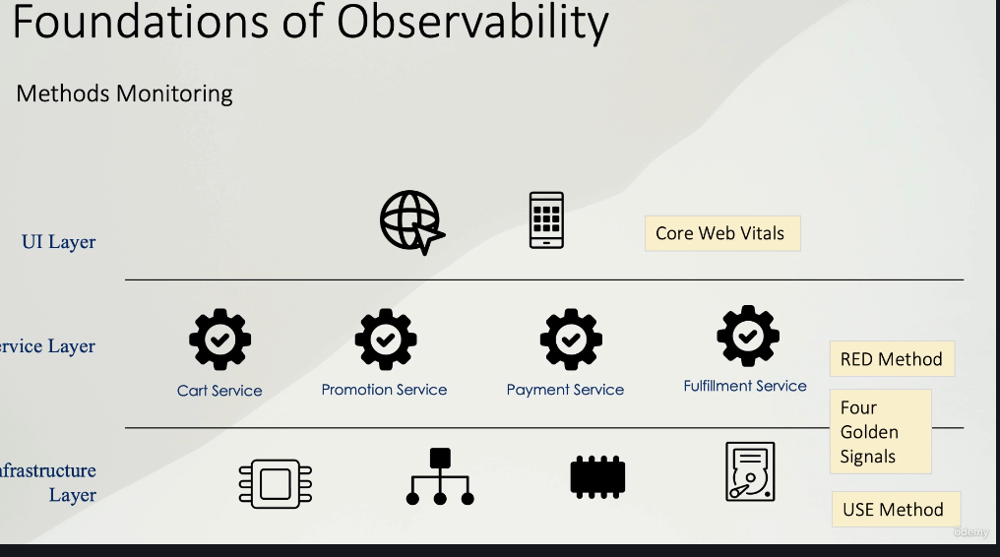

### Qué es
**Observabilidad** es la capacidad de **inferir el estado interno** de un sistema a partir de su **telemetría** (sus salidas). En microservicios, esta capacidad no se obtiene “por instalar herramientas”, sino por **diseñar señales** con semántica, contexto y coste controlado.

- Si la **monitorización** responde “¿se está degradando?”, la observabilidad permite responder “¿qué está ocurriendo realmente, dónde, y por qué?”.
- Observabilidad está orientada a **diagnóstico** y **evolución** del sistema, no solo a detección de incidentes.

### Conceptos clave (glosario mínimo)
**Telemetría**  
Conjunto de señales emitidas por el sistema:
- **Métricas** (agregados numéricos en el tiempo)
- **Logs** (eventos con contexto)
- **Trazas** (flujo end-to-end por dependencias)

**Monitorización**  
Práctica operativa basada en señales y umbrales/reglas para:
- detectar degradaciones
- generar alertas
- sostener dashboards “de operación”

**Analítica**  
Explotación (técnica y/o de negocio) sobre telemetría y datos agregados para:
- tendencias, cohortes, embudos
- anomalías y predicción
- optimización (producto, rendimiento, coste)

**SRE**  
Enfoque de operación basado en:
- **SLI/SLO** como contrato operativo
- alerting por impacto (p. ej., burn-rate)
- runbooks y ownership

### Foundations of Observability: capas del sistema y qué medir en cada una

Una forma práctica de aterrizar “observabilidad” es **pensar por capas**. Cada capa tiene *su* punto de vista del sistema, por lo que también tiene **métricas dominantes** y métodos recomendados. La regla es simple: cuanto más arriba estás, más cerca del **impacto de usuario**; cuanto más abajo, más cerca de **capacidad y recursos**.

---

#### 1) UI Layer (experiencia de usuario)

**Qué representa:** lo que el usuario percibe y experimenta: rendimiento real, errores en el cliente, disponibilidad “desde fuera”.

**Qué preguntas debe responder:**
- ¿La página/app es usable y rápida *para el usuario real*?
- ¿Hay errores de ejecución (JS), fallos de carga de assets o problemas de red?
- ¿La disponibilidad percibida coincide con la del backend?

**Método recomendado:** **Core Web Vitals** (y señales UX complementarias)
- **LCP**: percepción de carga del contenido principal.
- **FID** (o equivalente moderno de “responsiveness”): capacidad de respuesta a la interacción.
- **CLS**: estabilidad visual.
- Complementos típicos: errores JS, fallos de recursos (JS/CSS), tiempos de API desde el navegador, disponibilidad sintética.

**Notas prácticas:**
- Esta capa es la que mejor captura “impacto”, pero suele necesitar segmentación (device, network, región) con cuidado de no explotar cardinalidad.
- No sustituye a backend: te dice “duele”, no siempre “por qué”.

---

#### 2) Service Layer (microservicios / APIs)

**Qué representa:** el contrato de servicio: rutas críticas, transacciones, dependencias aguas abajo, degradación por carga y errores funcionales.

**Qué preguntas debe responder:**
- ¿Las operaciones críticas responden con éxito?
- ¿Se cumplen los SLOs de latencia por endpoint/operación?
- ¿Los errores vienen del servicio o de una dependencia?
- ¿Se está quedando sin margen (colas/pools/conexiones)?

**Método recomendado:** **Four Golden Signals (RED+S)**
1) **Traffic** (Rate/Throughput): requests/s, mensajes/s, jobs/s.  
2) **Errors**: ratio de fallos observables (5xx, timeouts, errores de negocio críticos).  
3) **Latency** (Duration): p95/p99 por ruta crítica.  
4) **Saturation**: backlog, pool exhaustion, conexiones, throttling.

**Notas prácticas:**
- **RED** es excelente para HTTP/gRPC, pero completa con **Saturation** (Golden Signals) para anticipar el “va a caer”.
- En asíncrono (colas/eventos), “Traffic/Latency” se reinterpreta: throughput de consumo, lag/backlog, age-of-oldest-message, retries/DLQ.

---

#### 3) Infrastructure Layer (plataforma y dependencias)

**Qué representa:** recursos y componentes que sustentan el servicio: compute, red, almacenamiento, DB, cache, colas, balanceadores, etc.

**Qué preguntas debe responder:**
- ¿Hay recursos o componentes al límite?
- ¿Existe contención o colas creciendo?
- ¿Hay errores del recurso (IO, red, DB) que expliquen fallos arriba?

**Método recomendado:** **USE Method**
- **Utilization**: uso (CPU, memoria, IOPS, conexiones, QPS en DB).
- **Saturation**: señales de contención/backpressure (CPU throttling, run queue, wait time, colas, locks).
- **Errors**: fallos de recurso (timeouts, resets, errores de disco, errores DB).

**Notas prácticas:**
- USE aporta el “por qué” operativo de muchas degradaciones del service layer (latencia y errores por saturación).
- Es clave para capacity planning y prevención.

---

#### Relación entre capas: cómo se encadenan los síntomas

- Un problema en **Infra** (saturación/errores) suele manifestarse en **Service** como aumento de **latencia** y luego **errores**.
- El usuario lo nota en **UI** como peor **LCP/responsiveness**, fallos, o simplemente “no carga”.
- Por eso, una buena monitorización no es “elegir un método”, sino **alinear métodos por capa** y enlazar dashboards/alertas para bajar de impacto a causa.

---

#### Resumen en tabla

| Capa | Objetivo | Método base | Señales dominantes |
|---|---|---|---|
| UI | Experiencia percibida | Core Web Vitals | LCP, responsiveness, CLS, errores JS, fallos de assets |
| Service | Salud del contrato | Golden Signals (RED+S) | tráfico, errores, latencia p95/p99, saturación (colas/pools) |
| Infra | Recursos y dependencias | USE | utilization, saturation, errors del recurso |

### Diferencias prácticas
| Concepto | Pregunta que responde | Horizonte | Ejemplo |
|---|---|---:|---|
| Telemetría | “¿Qué señales propaga el sistema?” | continuo | `http.server.requests`, logs JSON, spans de DB |
| Monitorización | “¿Va mal ahora?” | minutos–horas | alerta por error-rate, panel de latencia p95 |
| Observabilidad | “¿Qué ocurre por dentro y por qué?” | minutos–días | drill-down: métrica → traza → logs |
| Analítica | “¿Qué aprendemos / optimizamos?” | días–meses | tendencia de fallos por versión, funnel de conversión |

### Señales operables, no datos
Para que la observabilidad sea **operable**, cada señal debe cumplir al menos:

1) **Semántica**  
Qué mide/describe, unidad, granularidad, y cómo interpretarla.

2) **Contexto mínimo común**  
Campos que permiten correlación y segmentación (por ejemplo: `service`, `env`, `version`, `tenant`, `traceId`, `requestId`).

3) **Coste y límites**  
Volumen, cardinalidad, retención, sampling, y seguridad (PII/secrets).

4) **Ownership**  
Quién responde cuando esa señal alerta, quién mantiene dashboard/runbook, y cuándo se revisa.

---

### Decisiones y trade-offs (arquitectura de observabilidad)
A su vez, hacer las señales operables conlleva una serie de  **decisiones de arquitectura**. Trade-offs típicos:

#### 1) Granularidad vs coste (y rendimiento)
- Más detalle (más logs, más spans, métricas más dimensionales) mejora diagnóstico.
- Pero incrementa coste (ingesta, almacenamiento, consulta) y puede añadir overhead.

**Regla práctica:**  
- métricas: baja cardinalidad estricta  
- logs: contexto rico pero controlado  
- trazas: sampling y atributos diseñados

#### 2) Cobertura vs simplicidad
- “Todo instrumentado” crea una plataforma compleja de operar y mantener.
- “Solo lo esencial” puede dejar puntos ciegos en dependencias críticas.

**Regla práctica:** empezar por baseline (Golden Signals + correlación mínima) y crecer por iteraciones.

#### 3) Estándar vs personalización
- Estándares (OTel/Micrometer, convenciones de naming) dan consistencia multi-servicio.
- Instrumentación manual de negocio aporta valor diferencial, pero requiere disciplina.

**Regla práctica:** auto-instrumentación para lo transversal + manual solo donde responda a preguntas operativas reales.

#### 4) Diagnóstico vs compliance / riesgo
- Logs ricos ayudan al forense, pero aumentan riesgo (PII, secretos, tokens).
- Trazas pueden contener atributos sensibles si no se controla.

**Regla práctica:** política explícita de datos sensibles (redacción/enmascarado) + controles de acceso + retención adecuada.

#### 5) Predecibilidad vs flexibilidad
- SLOs y alerting estructurado aumentan predictibilidad operativa.
- Exploración ad-hoc y queries flexibles aumentan capacidad de descubrir unknown unknowns.

**Regla práctica:** SLO para lo crítico + exploración para lo incierto (incidentes nuevos, degradaciones raras).

---

### Buenas prácticas (visión global)
- **Definir preguntas operativas primero**: ¿qué debe poder responder un on-call en 5–10 minutos?
- **Baseline mínimo por servicio** (nivel 0): latencia p95/p99, tasa de errores, throughput, saturación + logs estructurados + trazas básicas.
- **Correlación desde el día 1**: `traceId/spanId` + `requestId` + `tenant` + `service/env/version`.
- **Separar salud de servicio vs salud de plataforma**: evita culpar al componente equivocado.
- **Diseñar convención y gobernanza**: naming, unidades, tags/atributos permitidos, políticas de PII.
- **Ownership claro**: dashboards/alertas con responsable, runbook y revisión periódica.
- **Adopción incremental**: evitar big-bang; priorizar valor temprano (capítulos 08 y 06).

---

### Antipatrones (visión global)
- **“Observabilidad = instalar Prometheus/Grafana”**: herramientas sin señales operables ni ownership.
- **Telemetría sin pregunta**: métricas/logs “por si acaso” → ruido, coste, y nadie las usa.
- **Cardinalidad descontrolada**: tags con IDs, rutas crudas, atributos explosivos.
- **Logs sin estructura**: texto libre sin campos de correlación y sin contexto mínimo.
- **Trazas incompletas**: sin spans de dependencias o sampling que pierde justo los casos problemáticos.
- **Alerting ruidoso**: umbrales sin estabilidad o sin runbook → fatiga y desatención.
- **PII/secrets en logs**: riesgo operativo, legal y de seguridad.

---

### Implementación típica / tooling (alto nivel)
> Nota: este capítulo no prescribe un stack; describe piezas.

- **Instrumentación**
  - OpenTelemetry (multi-lenguaje) / Micrometer (JVM/Spring)
  - MDC / contexto de trazas para correlación en logs
- **Recolección**
  - Agents / collectors (OTLP, scrapers)
- **Almacenamiento**
  - TSDB para métricas
  - Log store (indexado o basado en etiquetas)
  - Trace store para trazas distribuidas
- **Explotación**
  - Dashboards por servicio + plataforma
  - Alerting (idealmente por impacto/SLO)
  - Exploración ad-hoc (investigación de incidentes)

---

### Resumen / checklist (capítulo 00)
- [ ] Existe una definición operativa de observabilidad (no solo “tooling”).
- [ ] Se distinguen telemetría vs monitorización vs analítica (y su propósito).
- [ ] Hay baseline mínimo por servicio (Golden Signals + logs estructurados + trazas básicas).
- [ ] La correlación mínima está definida (`traceId/spanId/requestId/tenant/service/env/version`).
- [ ] Hay convenciones (naming, unidades, tags/atributos) y reglas de cardinalidad.
- [ ] Existe política explícita de PII/secrets (redacción/enmascarado) y control de acceso.
- [ ] Dashboards/alertas tienen ownership + runbook + revisión periódica.
- [ ] La adopción está planteada como roadmap incremental (capítulo 08).
