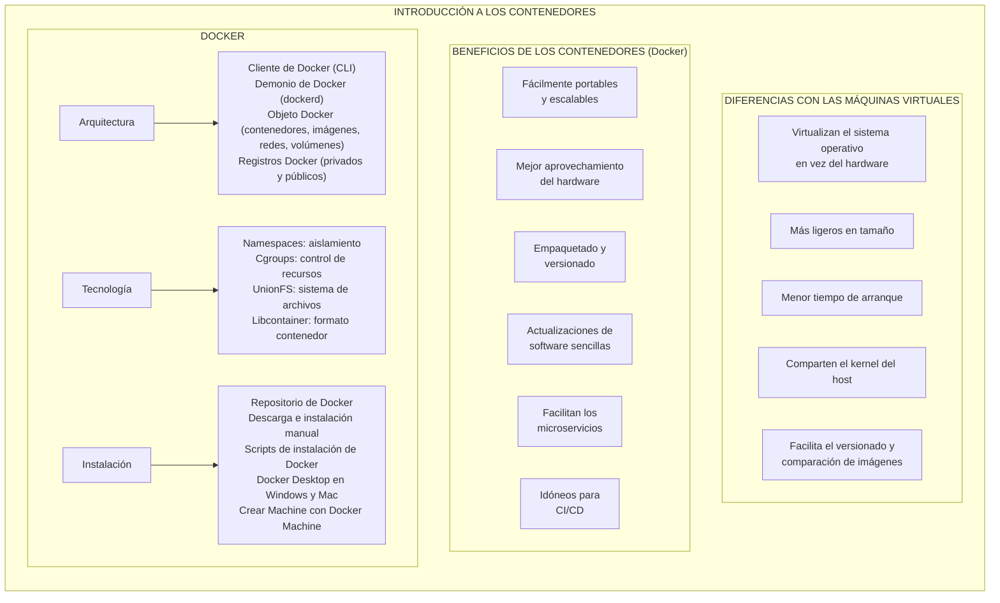
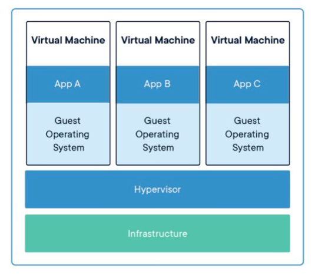
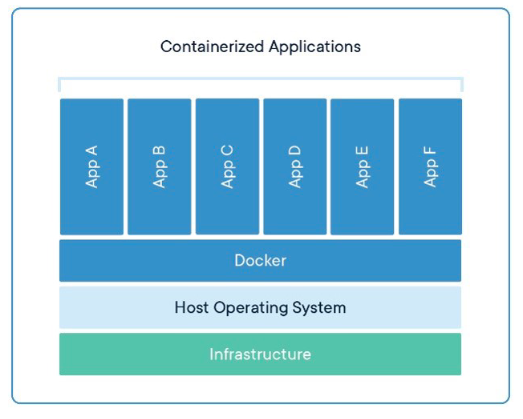
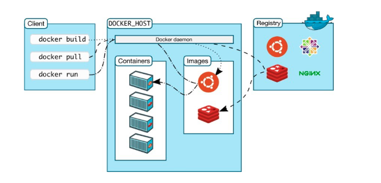

# Docker - Introducción

## Esquema 

## Hipervisor

### Definición

Un hipervisor es una capa de **software o firmware** que virtualiza el hardware de un host para crear, ejecutar y gestionar máquinas virtuales, asignándoles recursos y manteniendo su aislamiento.

### Funcionamiento

* Abstrae CPU, memoria, disco y red del host y los presenta como hardware virtual a cada VM.
* Planifica y reparte recursos (por ejemplo, tiempo de CPU y memoria) entre VMs.
* Aísla las VMs entre sí para que una no interfiera (directamente) con otra.
* Facilita el acceso a dispositivos (E/S), normalmente mediante controladores virtuales y/o passthrough según el caso.

## Tipos (mínimo imprescindible)

Tipo 1 (bare-metal): se ejecuta directamente sobre el hardware del host.

Tipo 2 (hosted): se ejecuta sobre un sistema operativo anfitrión.

## Máquina Virtual

### Definición 

Una máquina virtual (VM) es un entorno de ejecución que emula un S.O. completo y sus aplicaciones sobre un hipervisor, simulando un hardware propio.

### Funcionamiento

Las VMs se ejecutan sobre un hipervisor, que crea y gestiona cada máquina virtual.
El hipervisor asigna recursos del servidor físico (CPU, memoria, almacenamiento y red) a cada VM y mantiene su aislamiento.
Cada VM incluye su propio sistema operativo completo (kernel y servicios), además del software necesario, por lo que varias VMs pueden correr en paralelo en el mismo host.

## Docker

Para entender Docker es necesario introducir un par de elementos en los que se basa su ecosistema

### Imagen

#### Definición

Una imagen es un paquete inmutable que:
* contiene el **sistema de archivos de la aplicación** (binarios/código, dependencias y configuración por defecto) 
* sus **metadatos de ejecución** (por ejemplo, el comando de arranque). 
* **Sirve como plantilla** para crear contenedores.

### Contenedor

#### Definición

Un **contenedor** es (4 cosas) :
* **instancia aislada** creada a partir de una imagen
* ejecuta la aplicación de forma consistente entre entornos
* usando el kernel de la máquina anfitriona **sin hipervisor** 
* **más ligero** que una máquina virtual.

### Qué es Docker

**Docker** es una plataforma open source que permite:
* **construir, empaquetar, distribuir y desplegar** imágenes de aplicaciones, como contenedores.
* proporcionando mecanismos de aislamiento y un flujo de despliegue reproducible mediante imágenes y registros.

## Ciclo de Vida

1. Se construye la imagen: paquete reproducible con lo que la aplicación necesita para ejecutarse.
2. Distribuir la imagen: publicar la imagen para poder usarla en local, en un datacenter o en la nube.
3. Ejecutar la imagen: arrancar contenedores a partir de esa imagen de forma rápida y consistente.

### Arquitectura

* El cliente Docker lanza comandos (docker build, docker pull, docker run).
* Esos comandos se envían al Docker daemon del Docker host (local o remoto).
* El daemon:
    * construye y guarda imágenes en el host (build),
    * descarga/sube imágenes desde/hacia un registry (pull/push),
    * crea y ejecuta contenedores a partir de imágenes (run).
* El registry es el repositorio donde se almacenan imágenes versionadas (públicas o privadas).
* Nota práctica: 
    * docker run puede hacer pull automático si la imagen no existe en local.
    * Los **contenedores en ejecución** y la **máquina host** comparten el **mismo kernel**.

### Tecnologías Docker

#### Namespaces (espacios de nombres)

Docker utiliza **namespaces** como **espacios de trabajo aislados**. Cada aspecto del contenedor se ejecuta en un namespace separado y su acceso queda limitado a ese ámbito.

Namespaces de Linux usados por Docker:

- **pid**: aislamiento de **procesos**.  
- **net**: gestión/aislamiento de **interfaces de red**.  
- **ipc**: gestión del acceso a recursos de **IPC** (inter-process communication).  
- **mnt**: gestión de **puntos de montaje** del sistema de archivos.  
- **uts**: aislamiento de **hostname** e identificadores de versión (UTS).

#### Cgroups

Docker Engine también se basa en **cgroups** para **controlar recursos**. Un cgroup permite **limitar** y **gestionar** el uso de CPU, memoria, etc., por contenedor.

Ejemplo típico:
- limitar la **memoria** disponible para un contenedor concreto.

#### UnionFS

* **UnionFS** permite montar un sistema de archivos compuesto por la **unión de otros sistemas de archivos**.  
* Funciona por **capas**, lo que hace a las imágenes y contenedores **ligeros** y **rápidos**.

#### Formato de contenedor

Docker combina servicios de Linux como **namespaces**, **cgroups** y **UnionFS** en un “envoltorio” denominado **formato contenedor**.  
El formato de contenedor predeterminado de Docker es **libcontainer**.
