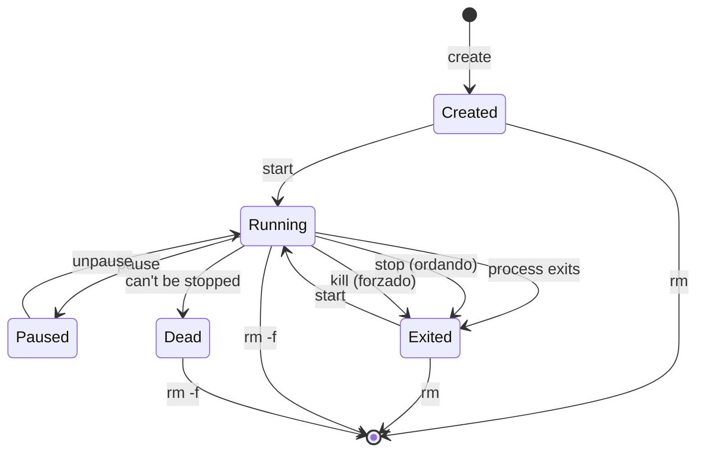

# Docker - Comandos

## Ciclo de vida del contenedorz

Los estados por los que puede pasar un contenedor docker  son los que se muestran en la imagen:



## Comandos de creación

En Docker hay una diferencia conceptual útil:

- `create` **crea** el contenedor (lo registra con su configuración) pero **no lo ejecuta**.
- `start` **arranca** un contenedor ya creado.
- `run` es un **atajo**: normalmente equivale a **(pull si falta) + create + start**. Por eso se usa tanto: en un solo comando se  define y ejecuta.

### ¿Cuándo usar cada uno?
- `run`: cuando se quiere levantar un contenedor inmediatamente, definiendo su configuración en la misma orden.
- `create` + `start`: cuando se quiere **separar** creación y ejecución, por ejemplo, preparar el contenedor con una config concreta y arrancarlo después, o cuando lo arrancan herramientas/orquestadores.

### Parámetros de `docker run`

En `docker run`, lo último (o lo que queda después de las opciones) no es un parámetro con `--`, pero **es obligatorio**: la **imagen** (y opcionalmente su tag/digest). Y, opcionalmente, el **comando** a ejecutar dentro del contenedor.

- `--name`: nombre del contenedor (si no, Docker genera uno).
- `-d` / `-it`: background vs interactivo con TTY.
- `--rm`: elimina el contenedor al salir (útil en pruebas).
- `-e` / `--env` / `--env-file`: variables de entorno.
- `-p` / `--publish`: publicación de puertos (`HOST:CONT` o `IP:HOST:CONT`).
- `-v` / `--volume` / `--mount`: volúmenes (persistencia/compartición de ficheros).
- `--network`: red a usar.
- `--restart`: política de reinicio.
- `--entrypoint`: override del entrypoint.

Y además:
- `IMAGE[:TAG]` o `IMAGE@DIGEST`: imagen a ejecutar.
  - ejemplo: `nginx:1.27` (`nginx` + tag `1.27`)
  - si omites tag: se asume `:latest`
- `[COMMAND] [ARG...]`: comando/args opcionales que sobrescriben el `CMD` de la imagen.
  - ejemplo: `nginx:1.27 nginx -g 'daemon off;'`

Regla mental:
- **Opciones** (`--...`, `-...`) configuran el contenedor.
- **IMAGE** selecciona la imagen base para crear el contenedor.
- **ENTRYPOINT** qué ejecutable es el “programa principal” del contenedor.
- **CMD** cuáles son los argumentos por defecto para ese programa (o, si no hay ENTRYPOINT, el comando por defecto).
- **COMMAND/ARGS** en docker run sobrescribe en tiempo de ejecución el CMD (y a veces del comando completo, según cómo esté definido el ENTRYPOINT).


## Ejemplo `docker run` (con parámetros típicos)

```bash
docker run --name web-demo --rm -d \
  -p 127.0.0.1:8080:80 \
  -e APP_ENV=dev \
  --restart unless-stopped \
  --network bridge \
  nginx:1.27
```

### Explicación parámetro a parámetro

* `docker run`: atajo que equivale, en esencia, a create + start (y hace pull si la imagen no existe localmente).
* `--name web-demo`: asigna un nombre al contenedor (si no, Docker genera uno).
* `--rm`: cuando el proceso termine, Docker elimina el contenedor (no se queda en Exited). Útil para pruebas.
* `-d`: ejecuta en background (detached).
* `-p` 127.0.0.1:8080:80: publica el puerto 80 del contenedor en el 8080 del host, pero solo escuchando en localhost (no expone a toda la red).
formato: IP_HOST:PUERTO_HOST:PUERTO_CONTENEDOR
* `-e APP_ENV=dev`: define una variable de entorno en runtime dentro del  contenedor (APP_ENV=dev).
* `--restart unless-stopped`: política de reinicio: se reinicia si cae o si Docker/host reinicia, salvo que lo hayas parado tú manualmente.
* `--network bridge`: conecta el contenedor a la red bridge (es la red por defecto; aquí se pone explícito para entender el parámetro).
* `nginx:1.27`: imagen y tag que se ejecutan. Tag específico (mejor que latest).

Nota práctica: si se ejecuta --rm junto con --restart, suele tener poco sentido en “servicios” (porque --rm es más de contenedores efímeros). En este ejemplo se usa para mostrar parámetros comunes, no como patrón ideal de producción.

## Variables de entorno

Las variables de entorno se usan para **parametrizar** el contenedor sin cambiar la imagen.

Fuentes típicas (de más “cercano” a más “lejano”):
1) `docker run -e KEY=VALUE ...` (runtime)
2) `--env-file file.env` (runtime)
3) `ENV KEY=VALUE` en Dockerfile (por defecto de la imagen)

Notas prácticas:
- Los secretos en `ENV` del Dockerfile: se quedan en la imagen.
- Variables en `docker run -e` son cómodas, pero para muchas variables suele ser mejor `--env-file`.

### Riesgos
Los secretos en los  casos 1 y 2 se quedan dentro del contenedor mientras existe:
* Un docker exec env o leer /proc/1/environ puede exponerlos a alguien con acceso al host/daemon Docker. Pueden aparecer en docker inspect (según cómo los pases)
* Las variables de entorno del contenedor suelen ser visibles en el JSON de docker inspect en la sección Config.Env. 
* Pueden filtrarse por logs o errores si la aplicación logea la configuración o hace stacktraces con vars, se van a logs.
* El fichero .env en disco es el riesgo más obvio,  si se commiteas, se copia al contexto de build por error, o se deja con permisos laxos, ahí sí hay exposición.
* **REGLA**. Para producción/orquestación: usar un mecanismo de secrets (Docker/Swarm secrets, Kubernetes Secrets + mounts, Vault, etc.) en vez de env vars cuando sean credenciales sensibles.


## Exposición de puertos

Regla mental:
- `EXPOSE` = intención/documentación
- `-p` = conectividad real desde fuera

- `EXPOSE 8080` (Dockerfile) **documenta** “este contenedor escucha aquí”. No abre ni publica nada.
- `-p HOST_PORT:CONTAINER_PORT` (runtime) **publica** el puerto del contenedor en el host.

Ejemplos:
- `docker run -p 8080:8080 miapp` (accedes al host en 8080) --> cualquier máquina de la red en la que se encuentra el localhost, si no hay medios que lo eviten pueden acceder a contenedor en el 8080)
- `docker run -p 127.0.0.1:8080:8080 miapp` (interfaz loopback) solo  accesible desde el localhost

```text
El host tiene IP 192.168.1.50:

1. -p 8080:8080:
* desde localhost: http://localhost:8080 ✅
* desde red: http://192.168.1.50:8080 ✅ (si firewall lo permite)

2. -p 127.0.0.1:8080:8080:
* localhost: http://localhost:8080 ✅
* desde  red: http://192.168.1.50:8080 ❌
```


## Interacción con contenedores: exec vs attach

### `docker exec`
Ejecuta **un proceso nuevo** dentro de un contenedor en ejecución.
- Ideal para: inspección, debug, shells puntuales.
- No dependes del proceso principal; creas otro.

Ejemplo:
- `docker exec -it miapp sh`

### `docker attach`
Te “enganchas” al **proceso principal (PID 1)** y a sus streams (STDIN/STDOUT/STDERR).
- Útil si el contenedor está en modo interactivo y quieres ver/usar su consola principal.
- Riesgo típico: si envías Ctrl+C puedes cortar el proceso principal (según configuración).

Regla rápida:
- Debug: `exec`
- Interactuar con la consola principal: `attach`

---

## Comandos operativos frecuentes (logs, cp, top, port)

| Comando | Para qué sirve | Cuándo lo usarías |
|---|---|---|
| `docker logs <c>` | Ver salida (stdout/stderr) del contenedor | Diagnóstico rápido sin entrar al contenedor |
| `docker logs -f <c>` | “Tail -f” de logs | Seguir la app en vivo |
| `docker cp <c>:/ruta ./local` | Copiar archivos desde el contenedor | Extraer artefactos, dumps, ficheros temporales |
| `docker cp ./local <c>:/ruta` | Copiar archivos al contenedor | Inyectar un config puntual o un fichero de prueba |
| `docker top <c>` | Ver procesos dentro del contenedor | Ver qué corre realmente / consumo sospechoso |
| `docker port <c>` | Ver mapeos de puertos publicados | Confirmar `-p` aplicado y puertos asignados |

Nota: `docker logs` funciona bien si la app **logea a stdout/stderr** (buena práctica en contenedores).

---

## Políticas de reinicio (restart policies)

Las políticas de reinicio controlan qué hace Docker si:
- el proceso termina (crash o exit),
- o se reinicia el daemon de Docker / el host.

Se configuran en runtime con `--restart`.

| Política | Comportamiento (simplificado) | Cuándo usarla |
|---|---|---|
| `no` (default) | No reinicia automáticamente | Contenedores de prueba / ejecución manual |
| `on-failure[:N]` | Reinicia solo si sale con código != 0 (hasta N) | Jobs/servicios donde “fallo” significa “reintenta” |
| `always` | Reinicia siempre (salvo `docker stop` manual) | Servicios que deben estar siempre arriba |
| `unless-stopped` | Como `always`, pero si lo paraste tú, no lo arranca al reiniciar daemon | Servicios persistentes administrados manualmente |

Matiz importante:
- Un reinicio por política **no arregla** un contenedor que se cae por mal config; solo evita que quede apagado.

---

## Puente hacia 3.4 (Almacenamiento) y 3.5 (Redes)

Estas secciones anteriores son “operativa base” (cómo ejecuto y opero contenedores).
Los dos bloques realmente estructurales para Docker como tecnología son:

- **Almacenamiento (volúmenes, bind mounts, capa RW, persistencia, backup, permisos)**
- **Redes (bridge, host, none, user-defined networks, DNS interno, puertos, comunicación entre contenedores)**

Cuando quieras, los atacamos en este mismo estilo.
