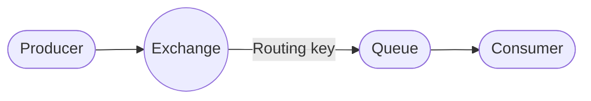

# 1. Introducción a AMQP en el contexto de la mensajería de eventos

En el ecosistema de **mensajería de eventos**, los sistemas distribuidos se comunican mediante **colas** y **brokers** que permiten el envío asíncrono y fiable de mensajes entre servicios.  
Entre los protocolos y plataformas más destacados se encuentran **AMQP**, **JMS**, **ActiveMQ**, **RabbitMQ**, y los sistemas **pub/sub** modernos (como Kafka o NATS).

## 1.1 ¿Qué es AMQP?

**AMQP (Advanced Message Queuing Protocol)** es un **protocolo estándar de mensajería** diseñado para garantizar la **interoperabilidad**, **fiabilidad** y **seguridad** en la comunicación entre aplicaciones.  
A diferencia de soluciones propietarias como JMS (Java Message Service), **AMQP define tanto el formato del mensaje como el comportamiento del broker**, permitiendo que distintos proveedores puedan comunicarse entre sí bajo las mismas reglas.

- 📜 **Estándar abierto** mantenido por OASIS.  
- 🔒 Incluye soporte para seguridad (TLS, autenticación).  
- 🔁 Garantiza entrega fiable (ack, confirmaciones, reintentos).  
- 🔄 Permite patrones de comunicación flexibles: *colas, publish/subscribe, routing, topics*, etc.

🔗 Comparativa rápida

| Tecnología | Tipo | Protocolo | Modelo principal | Uso típico |
|-------------|------|------------|------------------|-------------|
| **AMQP (RabbitMQ, Qpid)** | Protocolo | AMQP 0.9.1 / 1.0 | Queue + Pub/Sub | Mensajería general entre servicios |
| **ActiveMQ (JMS)** | Broker | JMS (API Java) | Queue + Topic | Integración Java EE / Spring |
| **Kafka** | Plataforma | TCP propietario | Pub/Sub persistente | Streaming y eventos a gran escala |
| **NATS** | Plataforma | NATS | Pub/Sub liviano | Microservicios de baja latencia |

AMQP actúa como **lenguaje común de mensajería** entre aplicaciones heterogéneas.  
Su diseño orientado a **interoperabilidad, fiabilidad y flexibilidad** lo convierte en una pieza clave dentro de arquitecturas **event-driven** y **microservicios**, especialmente cuando se busca un equilibrio entre robustez y simplicidad —como en el caso de **RabbitMQ**, su implementación más popular.

---

## 1.2 Diagrama conceptual (simplificado)

## 1.3 Elementos clave

RabbitMQ se basa en elementos básicos del protocolo AMQP, cuya funcionalidad se describe a continuación mediante analogía con sistema de distribución postal:

| Concepto RabbitMQ   | Analogía postal                               | Rol                                                                                                        |
| ------------------- | --------------------------------------------- | ---------------------------------------------------------------------------------------------------------- |
| **Producer**       | ✉️ **Remitente (persona que envía la carta)** | Es quien crea el mensaje y lo entrega en la oficina (exchange).                                            |
| **Exchange**        | 🏢 **Centro de distribución postal**          | Recibe las cartas, lee la dirección (routing key) y las envía por la ruta adecuada.                        |
| **Routing key**     | 🏷️ **Dirección postal escrita en el sobre**  | Indica a qué zona o destinatario debe llegar la carta.                                                     |
| **Binding**         | 🪢 **Ruta logística o regla de envío**        | Define qué buzones (queues) están conectados a qué centros (exchanges) y bajo qué criterios (direcciones). |
| **Queue**           | 📬 **Buzón del destinatario**                 | Donde se almacena la carta hasta que el destinatario la recoge.                                            |
| **Consumer**        | 👤 **Destinatario final**                     | La persona (o aplicación) que abre el buzón y lee la carta (procesa el mensaje).                           |
| **RabbitMQ Broker** | 🌍 **Servicio postal completo (Correos)**     | Todo el sistema: oficinas, rutas, buzones y personas trabajando juntas.                                    |

Nota sobre los **bindings**: no son recursos “con nombre” sino entradas de configuración que emparejan `exchange + queue + routing_key (y argumentos)`. Se crean con `queueBind` y se identifican precisamente por esa tupla; para cambiarlos hay que eliminar y crear la entrada de nuevo.
