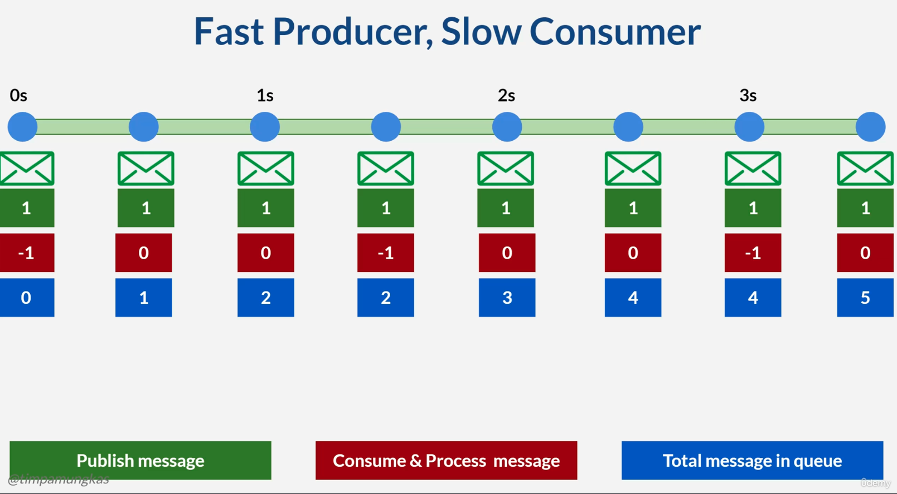
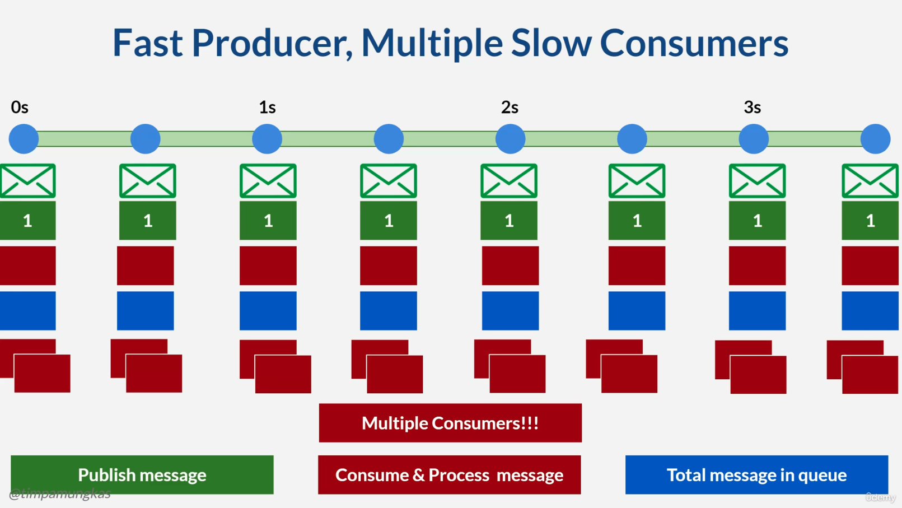
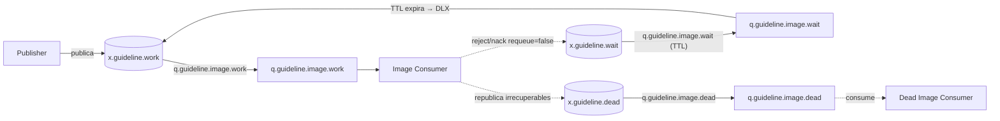

# 4. Patrones de consumo

## 4.1 Productor rápido, consumidor lento




* **Producer**
Un servicio web genera eventos muy rápido (peticiones de usuarios, logs, notificaciones…) y los publica en una cola.

* **Consumer**
El consumidor, hace operaciones lentas: llamadas HTTP a terceros, I/O de disco, operaciones pesadas de CPU, acceso a BD con índices malos, etc.

    Está infra-dimensionado: 1 instancia, 1 hilo, prefetch muy bajo, sin autoescalado.

## 4.2 Casos típicos

* Procesamiento de PDFs/imágenes, envío de emails/SMS, integraciones bancarias, notificaciones push, etc.

* Un pico de carga (Black Friday, campaña de marketing, batch nocturno) y el sistema no está preparado.

## 4.3 Evaluación
* Si el pico es puntual y luego el consumidor “se pone al día”, es sano
* Si la situación es sostenida, se tiene un problema estructural de capacidad.

## 4.4 Consecuencias

* Crecimiento de la cola
    * Más RAM o disco usado por RabbitMQ (mensajes en memoria o paginados a disco).
    * Posibles alarmas de memoria o disco en RabbitMQ → el broker puede bloquear productores.
* Latencia creciente
    * Cada mensaje tarda cada vez más en llegar al consumidor (espera en cola).
    * Mensajes “viejos” pueden perder valor (ej. notificación push que llega 20 minutos tarde).
* Riesgo de pérdida o expiración de mensajes
    * Si tienes TTL o límites de longitud, mensajes viejos pueden irse a DLX o perderse.
    * Si no tienes límites, la cola puede crecer hasta que el sistema sufra (swap, OOM, etc.).
* Impacto en UX y negocio
    * Emails que llegan tardísimo, pagos que se procesan con retraso, estados que no se actualizan.
    * Timeouts en otros servicios que esperan resultados derivados de esa cola.

## 4.5 Patrones que mitigan

* **Competing Consumers**. Varios workers leyendo de la misma cola para aumentar throughput.



Esta configuració es fácil de conseguir con Spring Rebbit, por ejemplo con la siguiente configuración, en la que se supone que el producer emite un evento cada medio segundo y hay tres consumidores simultáneos:

Producer
```java

@Service
@Slf4j
public class FixedRateProducer {
    @Autowired
    private RabbitTemplate rabbitTemplate;

    private int i=0;

    @Scheduled(fixedRate = 500)
    public void sendMessge() {
        i++;
        String message = "Fixed Rate Message " + i;
        rabbitTemplate.convertAndSend("course.fixedrate", message);
        log.info("Message sent to fixed rate queue: {}", message);
    }
}
```

Consumers
```java
@Service
@Slf4j
public class FixedRateConsumer {

    @RabbitListener(queues = "course.fixedrate", concurrency = "3-7")
public void listen(String message) throws InterruptedException {
        log.info("Thread {} consuming : {}", Thread.currentThread().getName(), message);
        TimeUnit.MILLISECONDS.sleep(ThreadLocalRandom.current().nextLong(2000));
    }
}
```

**Escalado vertical vs. horizontal en consumidores**

- Vertical (dentro del mismo proceso/pod): aumentas `concurrency` o threads en el listener. Mejora throughput si tienes CPU/RAM de sobra, pero sigues en una sola instancia: un crash afecta a todo y no se reparte carga entre nodos.
- Horizontal (más réplicas/pods del servicio): varias instancias del servicio compitiendo por la misma cola. Reparte carga entre nodos, aprovecha autoescalado del orquestador y da resiliencia; requiere que el código sea stateless o con estado externo compartido.
- En ambos casos son *competing consumers*: comparten la cola. Ajusta `prefetch` para evitar acaparar mensajes y calibrar bien el paralelismo real.
* **Back-pressure** (reactivo o manual) El consumidor controla cuántos mensajes puede recibir / procesar y el productor se adapta o se limita.
* **Throttling / Rate Limiting**. Limitar la producción de mensajes, especialmente si la fuente es externa (REST API).
* **Bulkhead** Aislar colas por tipo de trabajo/cliente para que un backlog en un flujo no arrastre a los demás.
* **Circuit Breaker + Fallback** Si el consumidor depende de un tercero lento o caído, corta y responde rápido (quizá encolando menos o nada).
* **Dead Letter Queue Pattern** Para mensajes que fallan repetidamente y ralentizan a todos.

## 4.6 Antipatrones que lo provocan

* **Un único consumidor monolítico y pesado** Hace de todo: valida, transforma, llama a 3 APIs, escribe en 2 BDs… y lo hace secuencialmente.
* **“Firehose” sin control** El productor publica todo lo que puede sin límite, sin mirar la capacidad del sistema.
* **Usar la cola como “base de datos histórica”** Sin TTL, sin x-max-length, sin cleanup.
* **Expectativa irreal** que no se pierda nada nunca y que se procese todo aunque tarde horas”.
* **Cola única para todo** Mezclar mensajes críticos con tonterías; si hay backlog, todo sufre.
* **Ignorar métricas**
    * No mirar messages_ready, messages_unacknowledged, publish_rate, ack_rate.
    * No tener alarmas sobre crecimiento sostenido de la cola.
* Handler que bloquea por diseño
    * Loops de reintentos infinitos dentro del consumidor.
    * Esperar respuestas síncronas muy lentas de otros sistemas en medio del procesamiento.    

## 4.7 Ejemplo completo: reintentos diferidos + DLQ final

Flujo típico para procesar mensajes con reintentos temporizados y parking lot:



Puntos clave:

- `q.guideline.image.wait` tiene `x-message-ttl` y `x-dead-letter-exchange = x.guideline.work` (opcionalmente `x-dead-letter-routing-key`); así reintenta tras esperar.
- `x.guideline.dead`/`q.guideline.image.dead` es la DLQ final para análisis o parking lot.
- `x-death` lo añade RabbitMQ al dead-letter: útil para contar reentregas sin tocar código.
- Tipo de exchanges: suelen ser `direct`/`topic`; `wait` reenvía a `work` vía DLX.

Cómo decide el consumidor si es recuperable:

- Clasifica excepciones: transitorias (timeouts, 5xx) → `nack/reject requeue=false` para que pasen por la cola de espera; irrecuperables (payload inválido, regla de negocio) → a la DLQ final.
- Usa `x-death` o un header propio para limitar reintentos: si `count` supera el umbral, lo marca irrecuperable.
- Con `acknowledge-mode: manual` decides `basicNack(..., requeue=true)` para reintento inmediato o `requeue=false` para enviar a wait/DLQ; con auto-ack, `AmqpRejectAndDontRequeueException` evita el requeue.
