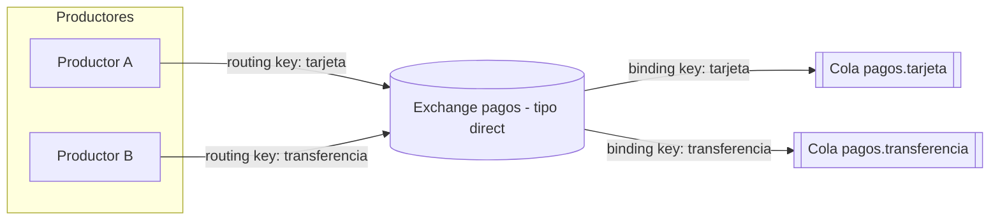
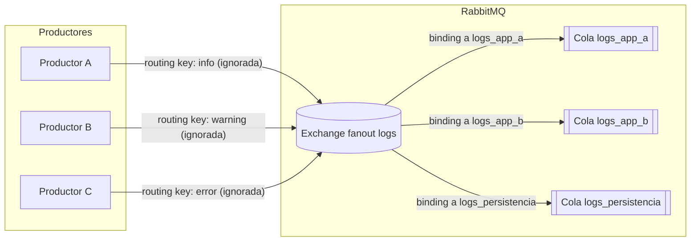
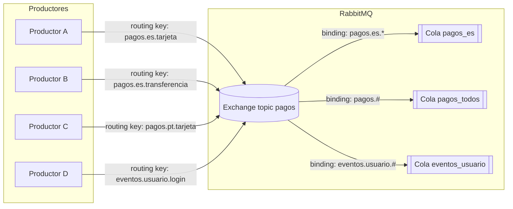
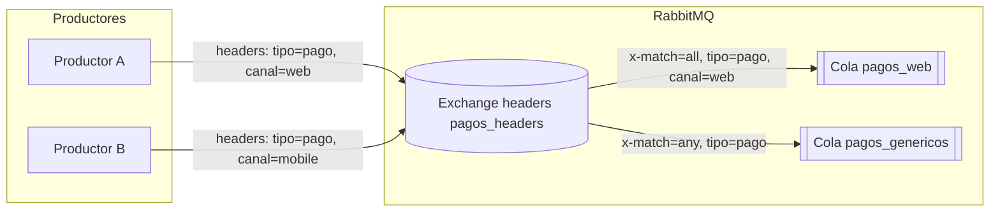
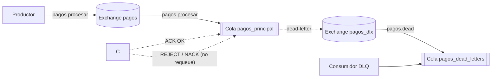

# 5. Exchanges en RabbitMQ

En RabbitMQ, un *exchange* es el componente que recibe los mensajes de los productores y decide a qué colas se envían, en función de las reglas de enrutado (bindings) configuradas. Los mensajes nunca se publican directamente en una cola, siempre pasan por un exchange.

RabbitMQ incluye varios tipos de exchange, cada uno con un algoritmo de enrutado distinto. Los cuatro básicos son:

* `direct`
* `fanout`
* `topic`
* `headers`

Además, existe un exchange por defecto (default exchange) y, mediante plugins, se pueden añadir tipos adicionales (por ejemplo, de "hash consistente" o "random").

## 5.1 Exchange directo (`direct`)

**Idea clave:** enrutado por igualdad exacta de clave de enrutamiento.

* Cada mensaje se publica con una **clave de enrutamiento** (routing key), que es una cadena.
* Cada binding entre el exchange y una cola se define con una **binding key**.
* El exchange envía el mensaje a todas las colas cuyos bindings tengan una clave exactamente igual a la routing key del mensaje.

Ejemplo típico:



* Cola `pagos.tarjeta` ligada al exchange `pagos` con binding key `tarjeta`.
* Cola `pagos.transferencia` ligada con binding key `transferencia`.
* Mensaje con routing key `tarjeta` → se entrega solo a `pagos.tarjeta`.

**Cuándo usarlo**

* Cuando necesitas **enrutado uno-a-uno (unicast)** o uno-a-pocos muy controlado.
* Casos de uso típicos:

  * Peticiones de tipo **Remote Procedure Call (RPC)**, donde cada respuesta debe ir a una cola concreta.
  * Varios "tipos" de mensaje bien definidos (p.ej. `info`, `warning`, `error`) sin necesidad de patrones.

## 5.2 Exchange de difusión (`fanout`)

**Idea clave:** broadcast: ignora la clave de enrutamiento y envía a todas las colas ligadas.

* Todo mensaje que entra en un exchange `fanout` se copia a **todas** las colas que tengan un binding con ese exchange, sin mirar la routing key.

Ejemplo típico:



* Exchange `logs` de tipo `fanout`.
* Colas `logs_app_a`, `logs_app_b`, `logs_persistencia` ligadas todas a `logs`.
* Cualquier mensaje publicado en `logs` se enviará a las tres colas.

**Cuándo usarlo**

* Necesitas **difundir el mismo mensaje** a múltiples consumidores:

  * Notificaciones globales (eventos de sistema, cambios de configuración).
  * Eventos que se procesan de formas diferentes en distintos servicios.
* No te importa filtrar por tipos de mensaje desde el exchange: cada consumidor filtra por su cuenta.

### Nota: mensajes no enrutables (direct/topic)

En exchanges `direct` y `topic`, si la routing key no coincide con ningún binding, el mensaje se **descarta**. No llega a ninguna cola ni a un DLX (el DLX solo aplica a mensajes ya encolados). Para evitar pérdidas:

* Configura un `alternate-exchange` para capturar los no enrutables.
* O publica con flag `mandatory` y maneja `basic.return` para reaccionar en el productor.

## 5.3 Exchange de temas (`topic`)

**Idea clave:** enrutado por patrón sobre la routing key (wildcards).

* La **routing key** es una lista de palabras separadas por puntos, por ejemplo:
  `pagos.es.tarjeta`, `pagos.us.transferencia`, `notificaciones.email.alta`.
* Las **binding keys** se definen como patrones con dos comodines:

  * `*` → exactamente un segmento.
  * `#` → cero o más segmentos.

Ejemplos:



* Binding key `pagos.es.*`:

  * Coincide con `pagos.es.tarjeta` y `pagos.es.transferencia`.
  * No coincide con `pagos.es` (falta un segmento).
* Binding key `pagos.#`:

  * Coincide con `pagos.es.tarjeta`, `pagos`, `pagos.us.transferencia`, etc.

**Cuándo usarlo**

* Necesitas **enrutado flexible por categorías**, como:

  * País / región / canal (`pagos.es.*`, `pagos.us.#`).
  * Tipo de evento (`eventos.usuario.*`, `eventos.pedido.#`).
* Cuando un `fanout` se queda corto y un `direct` es demasiado rígido.

En la práctica, el exchange de tipo `topic` es una generalización del `direct` con soporte de patrones.


## 5.4 Exchange de cabeceras (`headers`)

**Idea clave:** enrutado por cabeceras del mensaje, no por routing key.

* El enrutado se basa en un conjunto de **cabeceras** del mensaje (clave/valor).
* Cada binding define:

  * Una tabla de cabeceras a comparar.
  * Una propiedad especial `x-match` que indica si deben coincidir **todas** (`all`) o **alguna** (`any`) de las cabeceras.
* La routing key se ignora.

Ejemplo:



* Binding de la cola A:

  * Cabeceras: `{ "tipo": "pago", "canal": "web" }`
  * `x-match = "all"` → solo mensajes con ambas cabeceras con esos valores.
* Binding de la cola B:

  * Cabeceras: `{ "tipo": "pago" }`
  * `x-match = "any"` → cualquier mensaje con `tipo = pago`, sin importar el resto.

**Cuándo usarlo**

* Cuando el criterio de enrutado:

  * Se expresa mejor como un **conjunto de atributos** (p.ej. flags, versiones, tenant, etc.).
  * No encaja bien en una sola cadena estructurada (`routing key`).
* Útil si:

  * Los productores ya añaden muchas cabeceras con metadatos.
  * Quieres evitar acoplarte al formato de la routing key.

Ejemplo (Spring AMQP) enviando con cabeceras:

```java
import com.course.rabbitmq.prducer.entity.Furniture;
import com.fasterxml.jackson.core.JsonProcessingException;
import com.fasterxml.jackson.databind.ObjectMapper;
import lombok.RequiredArgsConstructor;
import org.springframework.amqp.core.Message;
import org.springframework.amqp.core.MessageProperties;
import org.springframework.amqp.rabbit.core.RabbitTemplate;
import org.springframework.stereotype.Service;

import java.nio.charset.StandardCharsets;


@Service
@RequiredArgsConstructor
public class FurnitureProducer {
    private final RabbitTemplate rabbitTemplate;
    private final ObjectMapper objectMapper;

    public void sendMessage(Furniture furniture) throws JsonProcessingException {
        MessageProperties props = new MessageProperties();
        props.setHeader("color", furniture.getColor());
        props.setHeader("material", furniture.getMaterial());

        String json = objectMapper.writeValueAsString(furniture);
        Message message = new Message(json.getBytes(StandardCharsets.UTF_8), props);
        rabbitTemplate.send("x.promotion", "", message); // exchange headers con bindings por color/material
    }
}
```

## 5.5 Exchange por defecto (default exchange)

RabbitMQ incluye un exchange especial, siempre presente:

* Es de tipo `direct`.
* No tiene nombre (cadena vacía `""`).
* Cada cola que se declara se liga automáticamente a este exchange usando su **nombre de cola** como binding key.

Consecuencias prácticas:

Aunque no se declare un exchange, en RabbitMQ siempre funciona uno al menos, el exchange por defecto (`default exchange`), de tipo `direct`, con nombre vacío: `""`.

Cada cola declarada queda automáticamente ligada a ese exchange por defecto con:

* `binding key` = `nombre de la cola`.

De estea foram cuado en Spring se realiza una acción del tipo:

* `convertAndSend("miCola", mensaje)` lo que dice el productor es:
    * publica en el `exchange` = `""`
    * con `routing_key` = `miCola`
    * Como el exchange `""` es de tipo `direct`, la regla es:  
        * Entrega el mensaje a todas las colas que tengan un binding cuya `binding key` == `routing key` del mensaje.


En realidad se está publicando a: `exchange` = `""` es decir _default exchange_ que no ha sido creado explícitamente, pero que ya existe en la configuración por defecto. De esta forma hace la asignación `routing key` = `"miCola"`

RabbitMQ mira los bindings del `exchange` `""`, ve que la cola `miCola` está ligada con binding key `miCola`, y entrega el mensaje ahí.

## 5.6 Exchanges para mensajes muertos (Dead Letter Exchange)

Un **Dead Letter Exchange (DLX)** no es un tipo especial a nivel técnico: es un exchange de tipo normal (`direct`, `topic`, etc.) al que una cola envía los mensajes que no ha podido procesar (expirados, rechazados, etc.), usando la propiedad `x-dead-letter-exchange` en la cola.

La idea básica es:

* Tienes una **cola principal** (donde se consumen los mensajes "sanos").
* Configuras esa cola con argumentos especiales:

  * `x-dead-letter-exchange`: nombre del exchange al que irán los mensajes muertos.
  * (Opcional) `x-dead-letter-routing-key`: routing key que se usará al reenviar esos mensajes.
* Esos mensajes se re-publican internamente hacia el DLX, y desde ahí se enrutan a **colas normales** (las llamadas dead-letter queues o colas de mensajes muertos).

Esto permite:

* Separar mensajes "sanos" de mensajes problemáticos.
* Enrutarlos a colas especiales para reintento, análisis o archivado.

### 5.6.1 Cuándo un mensaje se convierte en "dead letter"

Un mensaje pasa de la cola normal al DLX cuando ocurre alguna de estas situaciones típicas:

1. **Rechazo explícito del consumidor**

   * El consumidor envía `basic.reject` o `basic.nack` con `requeue = false`.

2. **Expiración de la TTL (Time To Live)**

   * TTL a nivel de mensaje (`expiration`).
   * TTL a nivel de cola (`x-message-ttl`).

3. **Superación de límites de la cola**

   * `x-max-length` (número máximo de mensajes).
   * `x-max-length-bytes` (tamaño máximo total en bytes).
   * Cuando la cola se "llena" según estas políticas, los mensajes expulsados pueden convertirse en dead letters.

Cuando se da alguna de estas condiciones, RabbitMQ:

1. Saca el mensaje de la cola principal.
2. Lo **republica internamente** en el exchange indicado por `x-dead-letter-exchange`, usando una routing key:

   * La original del mensaje, o
   * La definida en `x-dead-letter-routing-key` (si se ha configurado).


### 5.6.2 Usos habituales de DLX

#### Cola de parking / cuarentena

* Los mensajes problemáticos se apartan de la cola principal para no bloquear el flujo normal.
* Un servicio separado puede revisarlos, corregirlos o decidir descartarlos.

#### Reintentos con backoff

* En lugar de reencolar directamente en la cola principal, los mensajes fallidos van al DLX.
* Una cola ligada a ese DLX puede tener una TTL y a su vez un DLX de vuelta a la cola principal.
* Se crea así un patrón de reintentos con retraso (backoff) controlado.

#### Alertas y monitorización

* Un volumen inusual de mensajes en colas de dead letters puede indicar problemas de negocio o técnicos.
* Se puede monitorizar el tamaño de estas colas y disparar alertas.

En todos los casos, la idea clave es **separar el tráfico sano del problemático** sin perder mensajes y sin bloquear a los consumidores principales.

### 5.6.3 Esquema de flujo con DLX



Explicación:

* El productor envía mensajes al exchange normal `pagos`, que los enruta a la cola `pagos_principal`.
* El consumidor principal:

  * Si procesa bien, envía `ACK` y el mensaje desaparece.
  * Si falla y no quiere reencolar, envía `REJECT`/`NACK` sin requeue.
* En este último caso, la cola `pagos_principal` marca el mensaje como dead letter y lo envía al exchange `pagos_dlx`.
* El exchange `pagos_dlx` enruta el mensaje a la cola `pagos_dead_letters`, donde otro consumidor puede hacerse cargo de él (reintentos, análisis, archivado, etc.).


## 5.7 Exchanges adicionales mediante plugins

RabbitMQ permite habilitar tipos de exchange adicionales mediante plugins, como:

* Exchange de **hash consistente** (distribuye mensajes en función de un valor de hash).
* Exchange **random** (enrutado aleatorio entre colas).
* Exchange de **mensajes diferidos** (permite programar la entrega futura de mensajes).

Estos tipos son útiles para patrones más avanzados (balanceo de carga, retraso de mensajes, etc.), pero se basan en las mismas ideas básicas: exchange, bindings y colas.

## 5.8 Resumen comparativo

| Tipo de exchange | Criterio de enrutado                       | Usa routing key  | Usa cabeceras | Casos típicos                                  |
| ---------------- | ------------------------------------------ | ---------------- | ------------- | ---------------------------------------------- |
| `direct`         | Igualdad exacta routing key = binding key  | Sí               | No            | Enrutado directo, RPC, colas dedicadas         |
| `fanout`         | Broadcast a todas las colas ligadas        | Ignorada         | No            | Notificaciones globales, logs, eventos comunes |
| `topic`          | Patrón sobre routing key con `*` y `#`     | Sí (patrones)    | No            | Enrutado por categorías, país, tipo de evento  |
| `headers`        | Coincidencia de cabeceras (all/any)        | No               | Sí            | Enrutado por atributos complejos o metadatos   |
| Default (`""`)   | `direct` con binding automático por nombre | Sí               | No            | Casos simples, acceso directo a colas          |
| DLX              | Igual que tipo base (direct/topic/…)       | Depende del tipo | Depende       | Gestión de mensajes muertos, reintentos        |
